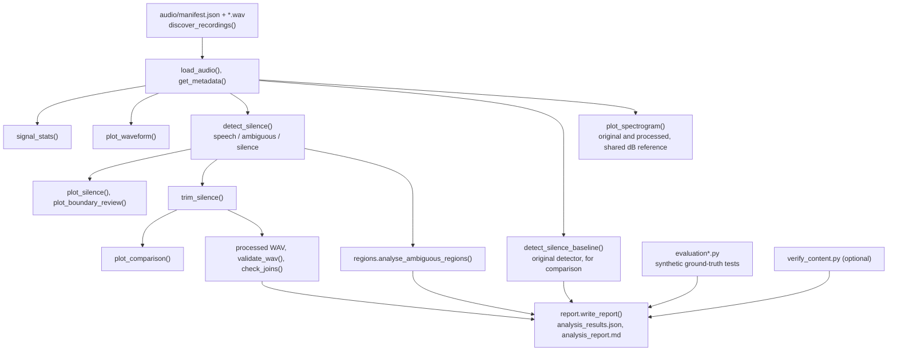
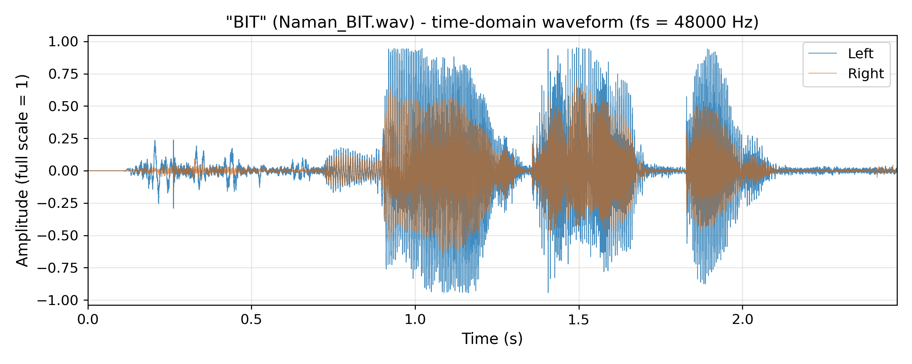
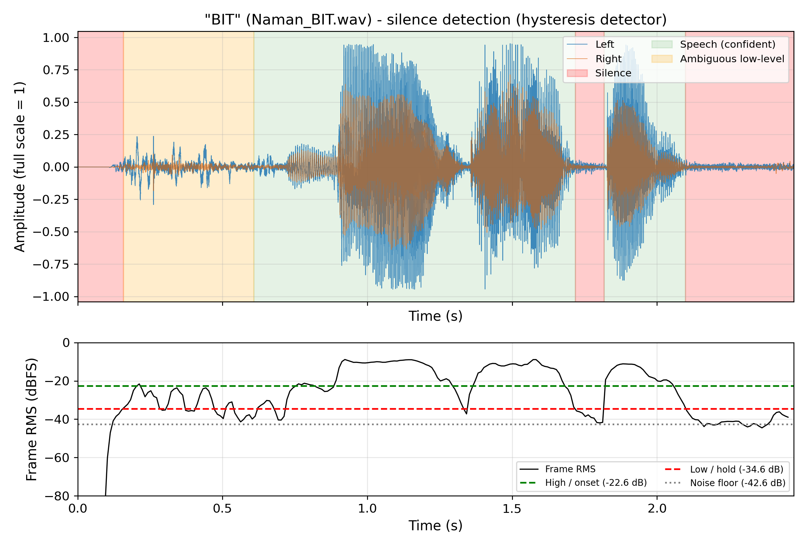
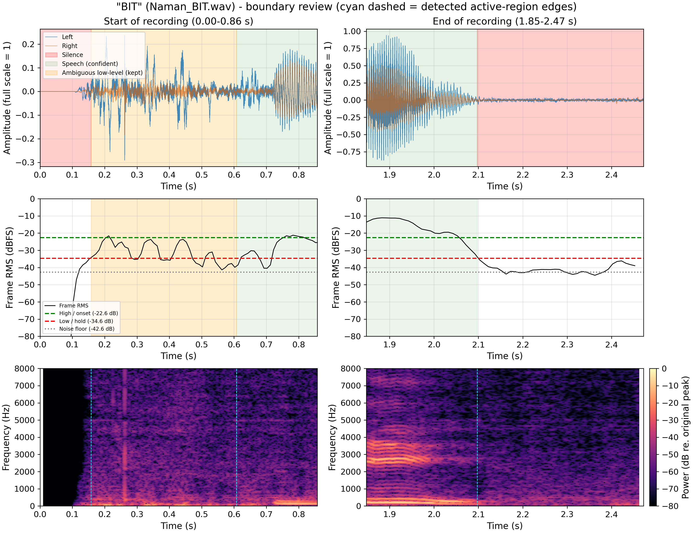
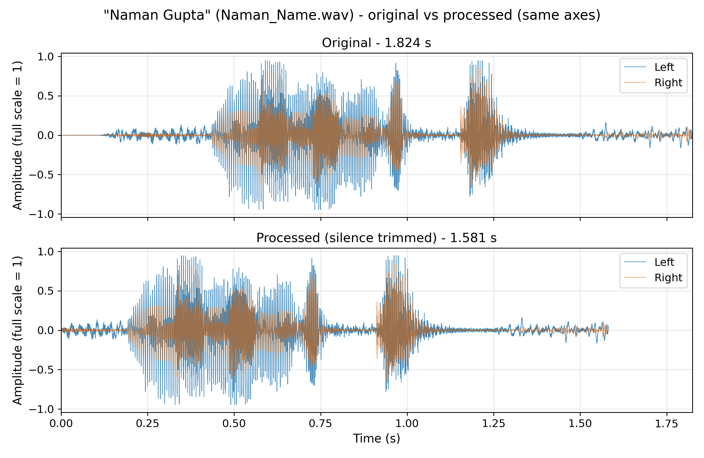
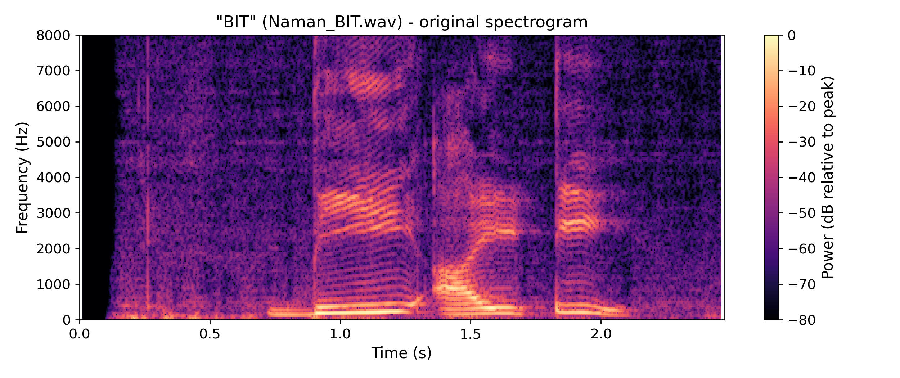
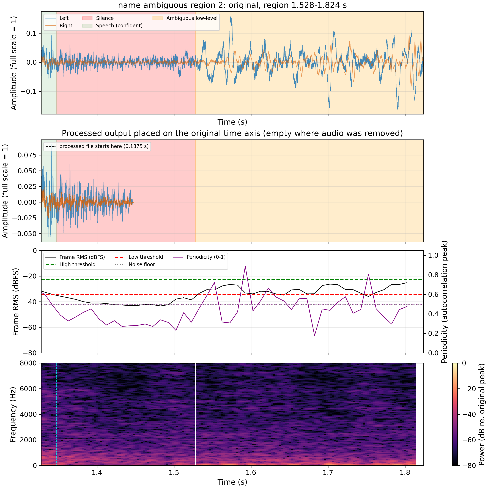
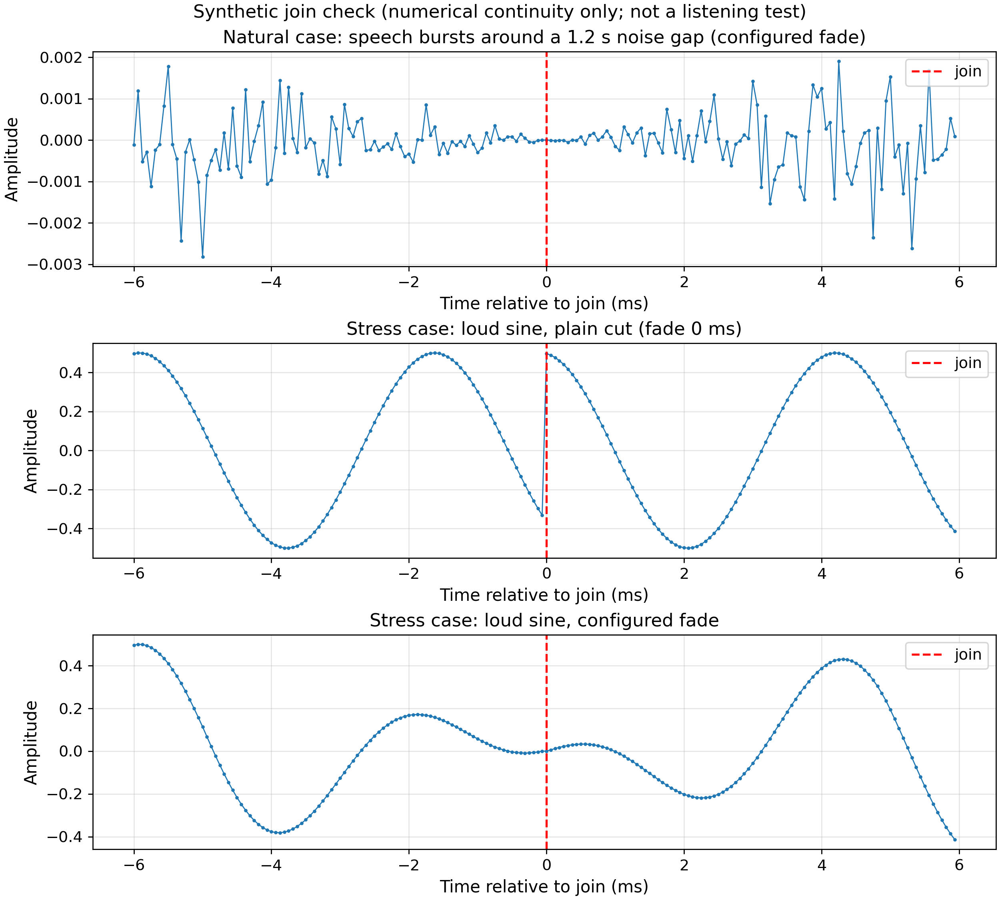

# Voice Signal Analysis and Silence Removal

**EC24313 – Artificial Intelligence and Machine Learning · Assignment 1**

**Made by:** Naman Gupta  
**Roll No:** BTECH/10887/24  
**Section:** C, ECE

A reproducible Python pipeline that analyses two short speech recordings ("BIT" and "Naman Gupta"): it extracts metadata, plots time-domain waveforms, detects and classifies silent regions, trims silence, and generates STFT spectrograms. Every figure, processed WAV file, measurement and report is produced by a single command.

This is an educational signal-processing project. It is not a speech-recognition or speaker-identification system.

## Highlights

- **Adaptive silence detection:** frame-RMS energy with a robust noise-floor estimate, hysteresis thresholds and an optional periodicity (voicing) check. Regions are classified as *speech*, *ambiguous* or *silence*.
- **Safe trimming:** padding around speech, fades at every cut, and a strict rule for shortening internal gaps. Input audio is never modified (verified by SHA-256).
- **Validated outputs:** each processed file is re-read and checked (sampling frequency, channels, sample count, finite values, clipping, original-file hash).
- **Tested on ground truth:** the new detector is compared with the original on 14 synthetic scenarios with known speech intervals, plus controlled non-speech and join tests.
- **Honest reporting:** results are labelled as measured, recognition-based, manual, synthetic or unverified.

## Results at a glance

| Recording | Sampling rate | Channels | Original | Processed | Removed |
|---|---|---|---|---|---|
| `Naman_BIT.wav` ("BIT") | 48 000 Hz | 2 | 2.472 s | 1.690 s | 0.782 s (31.6 %) |
| `Naman_Name.wav` ("Naman Gupta") | 48 000 Hz | 2 | 1.824 s | 1.260 s | 0.564 s (30.9 %) |

Both processed files pass all 11 applicable integrity checks. No internal gap was shortened, so the reduction comes from the start and end of each file. The three low-level "ambiguous" regions (see [Verification](#verification-of-uncertain-results)) are removed on the basis of a manual listening finding; with `trim_ambiguous=False` the reductions are 13.4 % and 3.2 %.

## Quick start

Requires Python 3.10+ (developed and run on 3.13).

```powershell
python -m venv .venv
.\.venv\Scripts\Activate.ps1
pip install -r requirements.txt
python assignment1.py                 # full analysis -> outputs/
python -m pytest tests -q             # 41 tests
python verify_content.py              # optional offline speech-recognition cross-check
```

On Linux/macOS activate with `source .venv/bin/activate`. Run from the repository root. Options: `--audio-dir DIR`, `--output-dir DIR`. Exit status: `0` success, `1` critical error, `2` a processed file failed validation. Reruns overwrite generated files only.

`verify_content.py` needs `faster-whisper` and a locally cached Whisper model (no download is attempted) and/or Windows' built-in speech recogniser. Without them the utterances are reported as *unverified*. Rerun `assignment1.py` afterwards to include the result in the report.

## How it works



### Audio representation

For `N` samples per channel at sampling frequency `f_s`, the duration is

$$T = \frac{N}{f_s}$$

`f_s` is read from the WAV header (`soundfile.info`) and is unrelated to the pitch of the voice. Both recordings are stereo; plots show both channels and the detector pools energy across channels (a plain channel average cancels out-of-phase channels).

### Silence detection

1. Frame RMS (dB) over **25 ms frames, 10 ms hop**, pooled over all channels.
2. **Noise floor** = median of the quietest 10 % of frames (digital-zero frames excluded). **Speech level** = 95th percentile.
3. **Hysteresis:** hold threshold = noise + 8 dB; onset threshold = noise + 20 dB (kept ≥ 10 dB below the speech level).
4. Dips shorter than 100 ms are bridged; runs shorter than 30 ms are dropped.
5. A run is confident **speech** if it has ≥ 30 ms above the onset threshold, extended by at most 150 ms (soft onsets and decays). The rest of the low-level activity is **ambiguous**.
6. If the speech level is less than 15 dB above the noise floor, no region is declared silent.
7. **Periodicity gate** (on by default): a high-energy cluster counts as speech only if it contains ≥ 30 ms of periodic frames (autocorrelation peak ≥ 0.5 at 70–400 Hz lags). This detects voicing, not speech.

The detector is energy-based with a voicing check; it does not identify words and is not a validated speech/non-speech classifier. The original single-threshold detector is kept as `detect_silence_baseline`, and its results are frozen in `outputs/baseline_results.json` (a test confirms it still reproduces them).

### Trimming

- Cut to the first and last speech region plus **100 ms** padding, with a 5 ms fade at every cut that is not the file's own edge.
- Shorten an internal gap (to 200 ms) **only if** it is longer than 400 ms and both neighbours are confident speech.
- Sampling frequency, channels and 16-bit PCM format are retained; no gain is applied.

### Spectrogram

$$X(m,k)=\sum_{n=0}^{N-1}x[n+mH]\,w[n]\,e^{-j2\pi kn/N}$$

Hann window `w[n]`, `N = 1024`, hop `H = 128` (at 48 kHz: 21.3 ms window, 2.7 ms hop, 46.9 Hz bin spacing), shown up to 8 kHz. **0 dB is the peak power of the original recording** and the processed spectrogram uses the same reference. `*_spectrogram_resolution.png` compares 512, 1024 and 2048-point windows.

## Detailed results

Amplitudes are relative to full scale; all values come from `outputs/analysis_results.json`.

| Metric | BIT original | BIT processed | Name original | Name processed |
|---|---|---|---|---|
| Samples per channel | 118 656 | 81 120 | 87 552 | 60 480 |
| Duration | 2.472 s | 1.690 s | 1.824 s | 1.260 s |
| Peak amplitude | 0.9523 | 0.9523 | 0.9477 | 0.9477 |
| RMS amplitude | 0.1615 | 0.1943 | 0.1666 | 0.1997 |

Processed RMS is higher because low-energy frames were removed from the average; the peak is unchanged.

**Detected regions**

| Recording | Regions (seconds) |
|---|---|
| BIT | silence 0–0.158 · **ambiguous 0.158–0.608** · speech 0.608–1.718 · silence 1.718–1.817 · speech 1.817–2.098 · silence 2.098–2.472 |
| Naman Gupta | silence 0–0.158 · ambiguous 0.158–0.287 · speech 0.287–1.347 · silence 1.347–1.528 · **ambiguous 1.528–1.824** |

### Synthetic evaluation (known ground truth)

`evaluation.py` uses deterministic speech-like signals (harmonic bursts plus filtered noise, 16 kHz). Frame-level F1 on a 10 ms grid; "preserved" is the fraction of true speech samples kept after trimming.

| Scenario | Baseline F1 | New F1 | Baseline preserved | New preserved |
|---|---|---|---|---|
| clean | 0.99 | 0.99 | 1.000 | 1.000 |
| SNR 20 dB | 1.00 | 1.00 | 1.000 | 1.000 |
| SNR 10 dB | 0.00 | 0.64 | 1.000 | 1.000 |
| speech fills almost the whole file | 0.48 | 1.00 | 0.981 | 1.000 |
| channels with opposite polarity | 0.00 | 0.99 | 1.000 | 1.000 |
| 300 ms noise burst in silence | 0.86 | 0.86 | 1.000 | 1.000 |

At 10 dB SNR the new detector cannot separate speech from noise and trims nothing. No F1 is reported for the real recordings because no labelled ground truth exists for them. The full table is in `outputs/analysis_report.md`.

## Verification of uncertain results

### Spoken content

`verify_content.py` runs two **offline** recognisers on 16 kHz mono copies (audio never leaves the machine):

| Recording | Declared | faster-whisper (local `faster-distil-whisper-medium.en`) | Windows System.Speech |
|---|---|---|---|
| `Naman_BIT.wav` | BIT | "BIT" ✔ | "The FBI B" ✘ |
| `Naman_Name.wav` | Naman Gupta | "Naman Gupta" ✔ | "Non little" ✘ |

Status: **partially supported**. Recognition output is supporting evidence, not ground truth, and the spoken content has not been confirmed by listening.

### Ambiguous low-level regions

Three regions sit 17–18 dB below the confident speech, have borderline periodicity (43–62 % of frames) and mostly low-frequency energy. These automated features are **inconclusive** (weak voicing, low-frequency noise and breath all produce them). **Manual listening, as reported by the author and recorded in `manual_listening.json`, found all three to be noise**; the setup and date were not recorded and the pipeline cannot verify this. They are therefore removed (apart from the 100 ms padding next to speech).

### Joins

Neither real output contains a join, so join-quality testing does not apply to them. On synthetic signals, a plain cut of a loud tone produced a sample step of 0.83 (fails the check) while the fade produced 0.00. This is numerical continuity only; perceptual smoothness has not been evaluated.

### Loud non-speech sounds

On synthetic clicks, white-noise bursts and breath-like noise, the periodicity gate cut the speech false-positive rate from 0.16–0.25 to 0.01–0.02. It does not help against a periodic 80 Hz thump, and a standalone unvoiced sound is no longer accepted as speech (with `trim_ambiguous=True` it loses 13 % of its samples). On the real recordings the gate changed no regions.

## Figures

All figures use time in seconds, frequency in Hz and amplitude relative to full scale.

**Waveform – "BIT".** Both channels; speech bursts near 0.9–1.3 s, 1.35–1.7 s and 1.85–2.1 s.



**Silence detection – "BIT".** Speech (green), ambiguous (orange) and silence (red), with frame RMS, noise floor and both thresholds below.



**Boundary review – "BIT".** Zoomed start and end: waveform, frame RMS and spectrogram. The lead-in before the first vowel shows isolated spikes and no harmonic stripes.



**Before and after – "Naman Gupta".** Same time and amplitude axes; the low-level start and tail are removed.



**Spectrogram – "BIT".** Colour is power in dB relative to the recording's peak. Voiced sounds appear as harmonic stripes, vowels as broad bright bands and plosive bursts as vertical lines.



**Ambiguous region focus – "Naman Gupta", 1.528–1.824 s.** Original waveform, processed output on the original time axis, frame RMS with periodicity, and spectrogram.



**Synthetic join check.** ±6 ms around a join in generated test signals (not the recordings).



Remaining plots are in `outputs/plots/`.

## Repository structure

```
.
├── assignment1.py          # pipeline: loading, detectors, trimming, validation, plots, CLI
├── evaluation.py           # synthetic ground-truth evaluation of both detectors
├── evaluation_events.py    # synthetic non-speech/feature evaluation and join validation
├── regions.py              # evidence for ambiguous regions, join plot, listening material
├── verify_content.py       # optional offline speech-recognition cross-check
├── report.py               # writes outputs/analysis_report.md
├── manual_review.json      # visual boundary observations (plots only)
├── manual_listening.json   # reported listening finding for the ambiguous regions
├── requirements.txt
├── audio/                  # Naman_BIT.wav, Naman_Name.wav (never modified), manifest.json
├── tests/test_assignment1.py
└── outputs/                # generated (baseline_results.json is a frozen reference)
    ├── analysis_results.json, analysis_report.md, content_verification.json
    ├── listening_checklist.md, listening_test/
    ├── plots/
    └── processed_audio/
```

| Output | Purpose |
|---|---|
| `outputs/analysis_results.json` | all measurements, parameters, intervals, baseline comparison, validation, synthetic evaluation |
| `outputs/analysis_report.md` | write-up of the same results, with evidence classes labelled |
| `outputs/processed_audio/*_processed.wav` | trimmed recordings |
| `outputs/plots/*.png` | waveforms, silence detection, boundary review, before/after, spectrograms, region focus, join check |
| `outputs/content_verification.json` | offline recognition transcripts and comparison |
| `outputs/listening_checklist.md`, `outputs/listening_test/` | clips and questions for manual listening |
| `outputs/baseline_results.json` | frozen results of the original detector |

## Configuration

All parameters are fields of the `Config` dataclass in `assignment1.py` (frame and hop length, thresholds, padding, gap rules, periodicity gate, spectrogram settings). `trim_ambiguous` defaults to `True`; set it to `False` to preserve ambiguous regions, which is the safer choice for recordings nobody has listened to.

## Technology

Python, NumPy (frame analysis), SoundFile (WAV I/O and metadata), SciPy (STFT, filters), Matplotlib (figures), pytest (tests). Optional: faster-whisper and Windows System.Speech for `verify_content.py`. Librosa is not used.

## Limitations

- Detection is energy-based with a voicing check; it is not a validated speech/non-speech classifier. Loud non-speech sounds can look like speech (a periodic thump passes the gate), and very quiet speech near the noise floor may be labelled ambiguous.
- Removing ambiguous regions can cut weak real speech in other recordings. The setting is justified here only by the listening finding for these two files, which was not independently verified.
- The noise floor assumes the quietest frames represent background noise; a recording without noise-only frames would break this.
- The spoken content is only partly supported by recognition, and nobody has confirmed it by listening. The processed audio and join smoothness have not been listened to.
- Synthetic results show behaviour on simplified signals and may not transfer to real recordings.
- Spectrogram appearance depends on window length, hop and dB range. No recognition accuracy or other downstream benefit is claimed.
