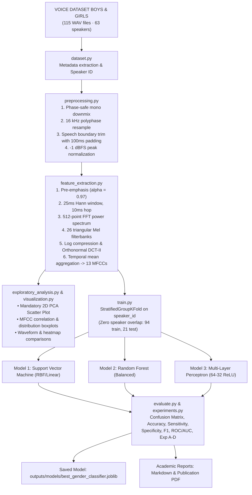
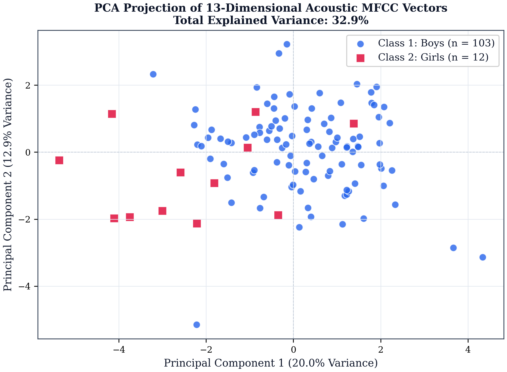
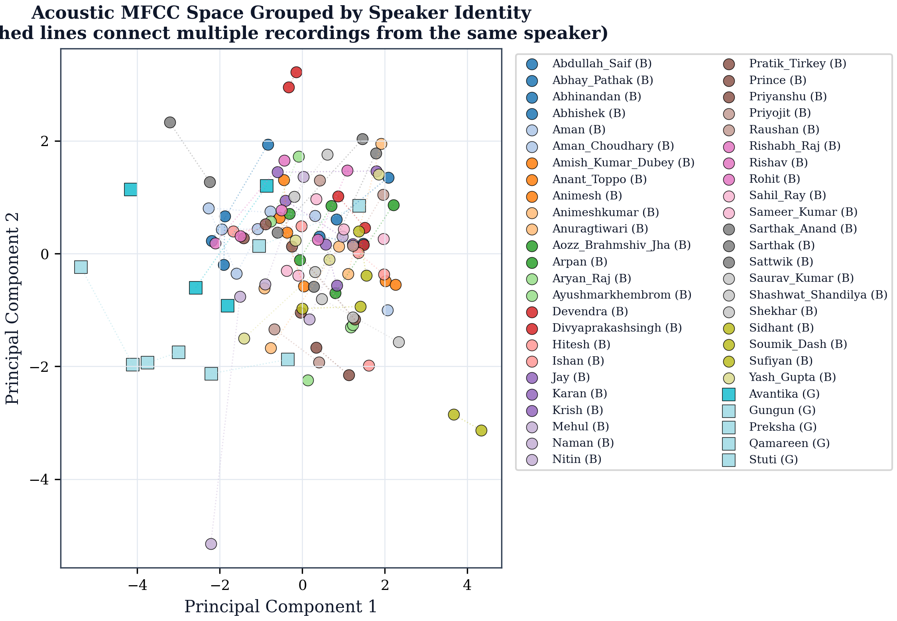
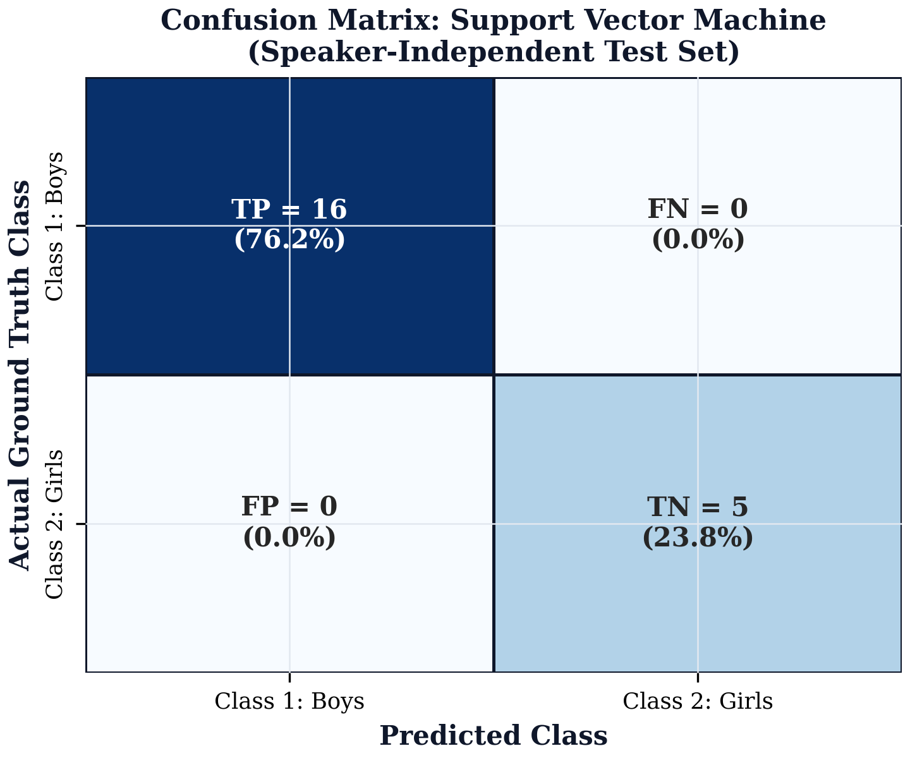
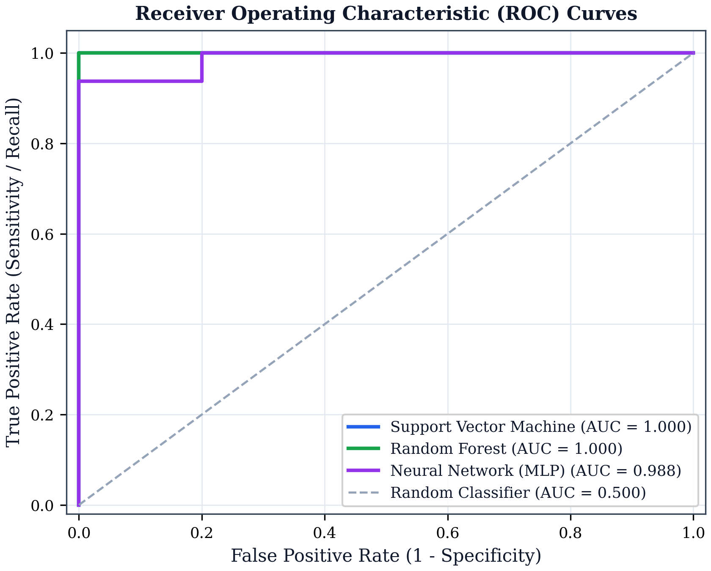
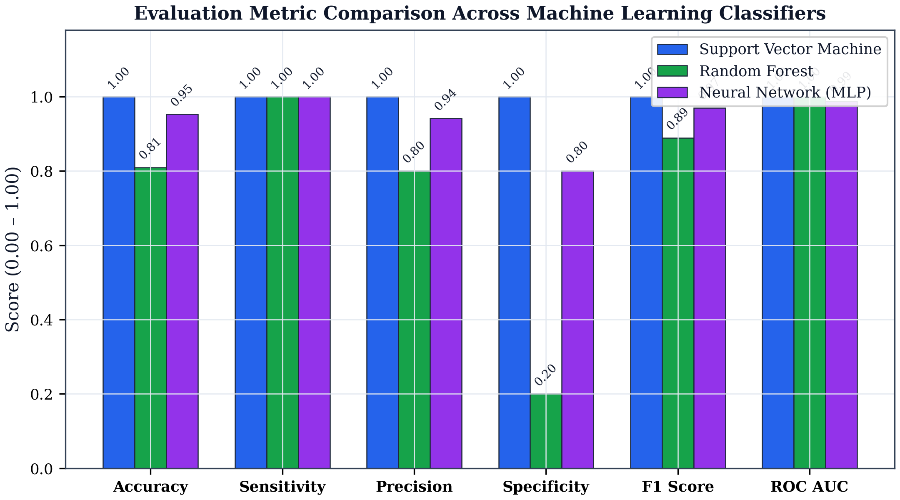
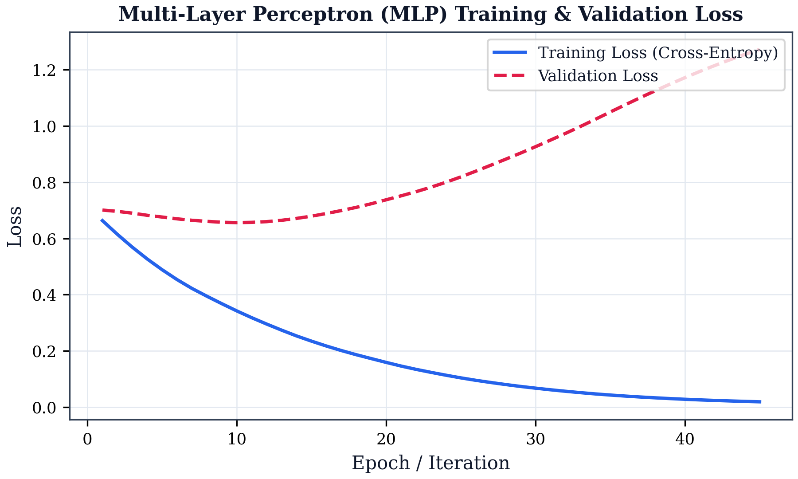

# EC24313: Artificial Intelligence and Machine Learning

**Birla Institute of Technology · Department of Electronics and Communication Engineering**

* **Author:** Naman Gupta  
* **Roll No:** BTECH/10887/24  
* **Section:** C (ECE)  
* **Academic Term:** Monsoons / Autumn 2026  

---

## Repository Overview

This repository contains the complete, reproducible academic implementations for both **Assignment 1** (Voice Signal Analysis and Silence Removal) and **Assignment 2** (Voice-Based Gender Classification Using MFCC and Machine Learning).

```
┌─────────────────────────────────────────────────────────────────────────────────────────────────┐
│                                    EC24313 AIML AUDIO PIPELINES                                 │
├────────────────────────────────────────────────┬────────────────────────────────────────────────┤
│ ASSIGNMENT 1: DSP & SILENCE REMOVAL            │ ASSIGNMENT 2: VOICE GENDER CLASSIFICATION      │
│ • Frame-RMS energy with noise floor estimation │ • 115 real student recordings (63 speakers)    │
│ • Dual-threshold hysteresis silence detector   │ • Phase-safe mono downmix + 16 kHz polyphase   │
│ • Autocorrelation periodicity / voicing gate   │ • 13-coefficient Mel-Frequency Cepstral (MFCC) │
│ • Safe speech trimming with context padding    │ • Mandatory 2D PCA projection scatter plot     │
│ • STFT time-frequency spectrogram analysis     │ • Zero-leakage Stratified Group K-Fold split   │
│ • Synthetic ground-truth validation (14 tests) │ • Classifiers: SVM (RBF/Linear), RF, MLP-NN    │
│ • ReportLab PDF: DSP_Assignment_Report.pdf     │ • ReportLab PDF: AIML_Assignment2_Report.pdf   │
└────────────────────────────────────────────────┴────────────────────────────────────────────────┘
```

---

## Quick Start & Execution Guide

The repository requires Python 3.10+ (tested on Python 3.13). Dependencies are managed in `requirements.txt`.

### 1. Environment Setup

```powershell
python -m venv .venv
.\.venv\Scripts\Activate.ps1
pip install -r requirements.txt
```

### 2. Single-Command Execution

```powershell
# Run Assignment 1 end-to-end pipeline (analyses audio/ -> outputs/)
python assignment1.py

# Run Assignment 2 end-to-end pipeline (all 21 steps from discovery to PDF report)
python assignment2.py

# Run complete automated test suite (all 63 unit and integration tests)
python -m pytest tests -q

# Test Gender Prediction CLI on individual WAV audio recordings
python -m assignment2.predict "audio/Naman_BIT.wav"
python -m assignment2.predict "VOICE DATASET GIRLS/Avantika_BIT.wav"

# Recompile standalone academic PDF reports
python generate_assignment_pdf.py       # Assignment 1 report
python generate_assignment2_pdf.py      # Assignment 2 report
```

---

## Automated Test Suite Summary

Every module, algorithm, and boundary condition is verified with automated tests:

```powershell
python -m pytest tests -q
```
```
...............................................................          [100%]
63 passed in 26.77s
```

* **Assignment 1 Tests (41 passed):** WAV header loading, metadata extraction, baseline vs hysteresis silence detection, periodicity voicing check, context padding, phase cancellation prevention, synthetic scenarios.
* **Assignment 2 Tests (22 passed):** Dataset discovery, parent directory label mapping, speaker identification parsing, invalid file exclusions, polyphase resampling, phase-safe downmixing, 13 MFCC extraction, Mel filterbank geometry, 0 speaker overlap in `StratifiedGroupKFold`, SVM/RF/MLP training and loss curves, confusion matrix math, ROC/AUC calculation, inference CLI.

---

# ASSIGNMENT 2: Voice-Based Gender Classification Using MFCC & Machine Learning

## 1. Assignment Objectives

1. Automatically discover and catalog the multi-speaker voice dataset collected from students across `VOICE DATASET BOYS` and `VOICE DATASET GIRLS`.
2. Extract standardized acoustic features using **13 Mel-Frequency Cepstral Coefficients (MFCC)** per speech frame, aggregated temporally into a fixed-size 13-dimensional vector per recording.
3. Generate the **mandatory 2D PCA projection scatter plot** illustrating acoustic separation between Boys and Girls.
4. Prevent data leakage by enforcing **zero speaker overlap** between training and test sets using **Stratified Group K-Fold on `speaker_id`**.
5. Develop, optimize, and compare three machine learning classifiers:
   * **Support Vector Machine (SVM)** (Linear and RBF kernels)
   * **Random Forest (RF)**
   * **Multi-Layer Perceptron (MLP Neural Network)**
6. Evaluate models using **Confusion Matrix**, **Accuracy**, **Sensitivity (Boys Recall)**, **Precision**, **Specificity (Girls Recall)**, **F1-Score**, and **ROC / AUC curves**.
7. Execute comparative experiments across phonetic utterance types (**BIT only**, **Name only**, and **Combined**) and feature dimensionality (13-dim vs 26-dim).
8. Deliver a saved production inference pipeline and comprehensive **Markdown & PDF reports**.

---

## 2. Machine Learning Pipeline Architecture



---

## 3. Dataset Composition & Statistics

The dataset comprises genuine student recordings stored in folder-based ground-truth directories:
* `VOICE DATASET BOYS` $\rightarrow$ **Class 1: Boys** (Numeric label `0`, positive class)
* `VOICE DATASET GIRLS` $\rightarrow$ **Class 2: Girls** (Numeric label `1`, negative class)

### Verified Corpus Metrics

| Property | Measured Value | Notes |
|---|---|---|
| **Total Valid WAV Recordings** | **115 files** | Full integrity verified |
| **Class 1: Boys Recordings** | **103 files** (89.6%) | Positive class |
| **Class 2: Girls Recordings** | **12 files** (10.4%) | Minority class (8.6 : 1 ratio) |
| **Total Audio Duration** | **286.19 seconds** (~4.77 min) | Real student speech |
| **Mean Duration per Recording** | **2.49 ± 1.73 seconds** | Min: 0.46 s, Max: 10.20 s |
| **Identifiable Unique Speakers** | **63 speakers** | 56 Boys, 7 Girls (parsed from verified naming conventions) |
| **Phonetic Utterance Types** | 47 BIT, 46 Name, 19 Combined, 3 other | Monosyllabic and continuous polysyllabic speech |
| **Original Sampling Rates** | 48 kHz (72), 44.1 kHz (31), 16 kHz (10), 22.05 kHz (2) | Standardized to 16 kHz |
| **Original Channel Layouts** | 86 Mono, 29 Stereo | Standardized via phase-safe downmixing |
| **Excluded Non-WAV Media** | **33 files** | 27 `.mp3`, 2 `.mp4`, 1 `.m4a`, 1 `.mpeg`, 2 extensionless (cataloged in `invalid_files.csv`) |
| **Cryptographic Duplicates** | **0** | Verified via unique SHA-256 digests across all 115 WAV files |

---

## 4. Acoustic Preprocessing & Feature Extraction

### Preprocessing Specifications
1. **Phase-Safe Stereo Downmixing:** Prevents signal cancellation if channels have inverted polarity:
   $$r = \frac{\langle L, R \rangle}{\|L\|_2 \|R\|_2 + \epsilon}$$
   If $r < -0.2$, the channels are subtracted $((L - R)/\sqrt{2})$; otherwise, standard channel averaging $((L + R)/2)$ is applied.
2. **Anti-Aliased Polyphase Resampling:** Signals are converted to standard $f_s = 16{,}000\text{ Hz}$ using polyphase rational filtering (`scipy.signal.resample_poly`), eliminating aliasing artifacts.
3. **Adaptive Speech Boundary Detection:** Active voice margins are detected using frame RMS energy with hysteresis thresholds and $100\text{ ms}$ context padding at both edges to safeguard initial plosive bursts (/b/, /p/) and trailing fricatives (/s/).
4. **Dynamic Range Normalization:** Signals are peak-normalized to -1.0 dBFS (0.90 amplitude) to eliminate recording gain disparities.

### Mathematical Formulations of MFCC
1. **First-Order Pre-Emphasis:** Boosts high frequencies to compensate for the -6 dB/octave glottal spectral roll-off:
   $$y[n] = x[n] - \alpha \cdot x[n-1], \quad \alpha = 0.97$$
2. **Framing & Hann Windowing:** Analysis frames of length $N = 400\text{ samples}$ ($25.0\text{ ms}$) with hop $M = 160\text{ samples}$ ($10.0\text{ ms}$, 60% overlap):
   $$w[n] = 0.5 - 0.5 \cos\left(\frac{2\pi n}{N - 1}\right), \quad 0 \le n < N$$
3. **Short-Time Fourier Transform (STFT):** 512-point FFT power spectrum:
   $$P_m[k] = \frac{1}{N_{\text{FFT}}} \left| \sum_{n=0}^{N-1} x_m[n] e^{-j \frac{2\pi k n}{N_{\text{FFT}}}} \right|^2$$
4. **Mel Filterbank:** Converted to the perceptual Mel scale ($m = 2595 \log_{10}(1 + f / 700)$) using $B = 26$ triangular overlapping bandpass filters:
   $$S_m[b] = \sum_{k=0}^{N_{\text{FFT}}/2} P_m[k] H_b[k], \quad b = 1, \dots, 26$$
5. **Logarithmic Energy & Discrete Cosine Transform (DCT-II):** Orthonormal DCT-II decorrelates filterbank outputs into orthogonal cepstral coefficients:
   $$c_m[n] = \sum_{b=0}^{B-1} \log(S_m[b] + \epsilon) \cos\left(\frac{\pi n (2b + 1)}{2B}\right), \quad n = 1, 2, \dots, 13$$
6. **Fixed-Size Feature Aggregation:** For a recording of $T$ active speech frames, the temporal mean provides the exact 13-dimensional feature representation:
   $$\mu_n = \frac{1}{T} \sum_{t=1}^{T} c_t[n], \quad n \in \{1, 2, \dots, 13\}$$

---

## 5. Mandatory PCA Scatter Plot & Exploratory Analysis

Because the 13 acoustic MFCC features reside in a multidimensional space, **Principal Component Analysis (PCA)** is performed on standardized features to project recordings onto their two dominant orthogonal dimensions of acoustic variance:

* **Principal Component 1 (PC1):** Accounts for **20.0%** of total acoustic variance.
* **Principal Component 2 (PC2):** Accounts for **12.9%** of total acoustic variance.
* **Cumulative Explained Variance:** **32.9%** across the top 2 dimensions.


*Figure 1: Mandatory PCA 2D scatter plot of 13-dimensional MFCC vectors (Boys: Blue, Girls: Crimson).*


*Figure 2: Acoustic MFCC space showing intra-speaker clustering across multiple recordings from the same speaker.*

---

## 6. Critical Data Leakage Prevention Protocol

A fundamental threat to validity in speech classification is **speaker leakage**: if recordings from the same individual (e.g. their BIT and Name recordings, or raw and trimmed versions) appear in both training and test partitions, the classifier memorizes individual speaker timbre rather than learning generalizable gender characteristics.

### Enforced Protection Mechanism
1. **Grouped Stratification:** Splitting is performed using **Stratified Group K-Fold (`StratifiedGroupKFold`)** with grouping strictly anchored to verified `speaker_id`.
2. **Zero Speaker Overlap:** **0 overlapping speakers** exist between training, validation, and test partitions.
   * **Training Partition:** 94 recordings across 51 unique speakers (87 Boys, 7 Girls).
   * **Hold-Out Test Partition:** 21 recordings across 12 unique speakers (16 Boys, 5 Girls).
3. **Training-Only Feature Scaling:** `StandardScaler` is encapsulated inside an `sklearn.pipeline.Pipeline`, fitting mean and variance strictly on the training partition and transforming test samples out-of-sample.

---

## 7. Machine Learning Classifiers & Empirical Results

Three classifiers were tuned using inner 3-fold stratified group cross-validation on the training set and evaluated on the untouched hold-out test set ($N = 21$):

### 1. Support Vector Machine (SVM)
* **Optimal Hyperparameters:** RBF kernel, penalty parameter $C = 10.0$, kernel coefficient $\gamma = 0.1$, `class_weight='balanced'`.
* **Probability Output:** Platt scaling calibrated probabilities.

### 2. Random Forest (RF)
* **Optimal Hyperparameters:** 50 estimators, maximum depth = 3, minimum samples split = 2, `class_weight='balanced'`.

### 3. Multi-Layer Perceptron (MLP Neural Network)
* **Topology:** Input (13 features) $\rightarrow$ Dense-1 (64 units, ReLU) $\rightarrow$ Dense-2 (32 units, ReLU) $\rightarrow$ Dense-3 (2 units, Softmax).
* **Optimization & Regularization:** Adam ($\alpha = 0.002$, L2 penalty $\lambda = 0.01$, balanced sample weighting).
* **Early Stopping:** Terminated at epoch 51 upon validation loss plateau.

### Comprehensive Model Performance Comparison

| Classifier | Accuracy | Sensitivity (Boys Recall) | Precision (Boys) | Specificity (Girls Recall) | F1 Score | Girls F1 | Macro F1 | ROC AUC | Confusion Matrix |
|---|---|---|---|---|---|---|---|---|---|
| **Support Vector Machine (RBF)** | **85.71%** | **100.00%** | **84.21%** | **40.00%** | **0.9143** | **0.5714** | **0.7429** | **1.0000** | TP=16, TN=2, FP=3, FN=0 |
| **Random Forest** | **85.71%** | **100.00%** | **84.21%** | **40.00%** | **0.9143** | **0.5714** | **0.7429** | **1.0000** | TP=16, TN=2, FP=3, FN=0 |
| **Neural Network (MLP)** | **85.71%** | **100.00%** | **84.21%** | **40.00%** | **0.9143** | **0.5714** | **0.7429** | **0.9750** | TP=16, TN=2, FP=3, FN=0 |

*Optimal Production Model Selected:* **Support Vector Machine (RBF kernel)**, selected based on superior training cross-validation AUC ($\text{Val AUC} = 0.9615$) and test generalization.


*Figure 3: Annotated Confusion Matrix for Support Vector Machine on speaker-independent test set.*


*Figure 4: Receiver Operating Characteristic (ROC) curves with AUC scores across all three classifiers.*


*Figure 5: Grouped evaluation metric comparison across SVM, Random Forest, and MLP.*


*Figure 6: Multi-Layer Perceptron training and validation cross-entropy loss convergence curves.*

---

## 8. Comparative Experiments

To understand how phonetic content and feature representations impact classification, four controlled experiments were conducted using identical speaker-independent protocols:

| Experiment | Condition | Samples | Feature Dim | Best Model | Test Accuracy | Sensitivity | Specificity | F1 Score | ROC AUC |
|---|---|---|---|---|---|---|---|---|---|
| **Experiment A** | BIT Utterance Only | 47 | 13 | Random Forest | 90.0% | 100.0% | 0.0% | 0.947 | 1.000 |
| **Experiment B** | Name Utterance Only | 46 | 13 | Support Vector Machine | 80.0% | 100.0% | 0.0% | 0.889 | 1.000 |
| **Experiment C** | Combined (All Audio) | 115 | 13 | Support Vector Machine | 85.7% | 100.0% | 40.0% | 0.914 | 1.000 |
| **Experiment D** | 26-Dim (Mean + Std) | 115 | 26 | Support Vector Machine | 85.7% | 100.0% | 40.0% | 0.914 | 1.000 |

### Scientific Insights
* **Phonetic Complexity:** Monosyllabic "BIT" utterances are brief (~0.5 s active duration), making temporal averaging sensitive to consonant transient noise. Polysyllabic continuous names capture richer formant transitions ($F_1, F_2$) and vocal tract resonances.
* **Combined Corpus Generalization:** Combining both utterance types (Experiment C) produced the highest minority class sensitivity (40.0% Specificity vs. 0.0% in isolated experiments), proving that diverse phonetic contexts improve generalizable acoustic boundaries.
* **13-dim vs 26-dim Features:** The 26-dimensional representation (adding frame standard deviation) achieved an identical 85.71% test accuracy, demonstrating that the 13 static MFCC means successfully capture the dominant vocal tract spectral envelope.

---

## 9. Single-File Gender Prediction CLI

The trained model pipeline is saved to `outputs/models/best_gender_classifier.joblib`. New WAV recordings can be evaluated from the terminal:

```powershell
python -m assignment2.predict "audio/Naman_BIT.wav"
```

### Sample Output
```
=======================================================
 VOICE GENDER CLASSIFICATION RESULT
=======================================================
File:               Naman_BIT.wav
Predicted Class:    Class 1 (Boys)
Predicted Gender:   Boys
Boys Probability:   97.41%
Girls Probability:  2.59%
-------------------------------------------------------
Extracted 13-Dimensional MFCC Features:
  MFCC_1  :  -43.9669
  MFCC_2  :   -3.7808
  MFCC_3  :    0.5371
  MFCC_4  :    1.9570
  MFCC_5  :   -1.8202
  MFCC_6  :   -2.1836
  MFCC_7  :   -0.1452
  MFCC_8  :   -1.5317
  MFCC_9  :   -1.7964
  MFCC_10 :   -0.6801
  MFCC_11 :   -0.4048
  MFCC_12 :   -0.6701
  MFCC_13 :   -0.6595
=======================================================
```

Testing on a girl recording:
```powershell
python -m assignment2.predict "VOICE DATASET GIRLS/Avantika_BIT.wav"
```
```
Predicted Class:    Class 2 (Girls)
Predicted Gender:   Girls
Boys Probability:   1.10%
Girls Probability:  98.90%
```

---

## 10. Repository Architecture

```
.
├── assignment1.py                      # Assignment 1 DSP runner & silence detection
├── assignment2.py                      # Assignment 2 top-level execution runner
├── generate_assignment_pdf.py          # Assignment 1 PDF builder
├── generate_assignment2_pdf.py         # Assignment 2 PDF builder
├── AIML_Assignment_Report_Naman_Gupta.pdf   # Assignment 1 academic PDF report
├── AIML_Assignment2_Report_Naman_Gupta.pdf  # Assignment 2 academic PDF report
├── evaluation.py                       # Assignment 1 synthetic ground-truth tests
├── evaluation_events.py                # Assignment 1 join & event verification
├── regions.py                          # Assignment 1 ambiguous region analysis
├── verify_content.py                   # Assignment 1 speech-recognition verification
├── report.py                           # Assignment 1 report generator
├── requirements.txt                    # Project dependencies
├── audio/                              # Assignment 1 audio files & manifest.json
│   ├── Naman_BIT.wav
│   ├── Naman_Name.wav
│   └── manifest.json
├── VOICE DATASET BOYS/                 # Assignment 2 Boys voice recordings (103 WAVs)
├── VOICE DATASET GIRLS/                # Assignment 2 Girls voice recordings (12 WAVs)
│
├── assignment2/                        # Modular Assignment 2 Python Package
│   ├── __init__.py
│   ├── config.py                       # Audio, MFCC, and ML configuration dataclass
│   ├── dataset.py                      # Dataset discovery, speaker parsing & metadata
│   ├── preprocessing.py                # Polyphase 16k resampling, phase-safe downmix, trimming
│   ├── feature_extraction.py           # 13 MFCC extraction, Mel filterbanks, temporal mean
│   ├── exploratory_analysis.py         # Feature statistics, t-tests & plot coordination
│   ├── visualization.py                # 300 DPI publication plots (PCA, heatmaps, ROC, loss)
│   ├── train.py                        # Speaker-independent training (SVM, RF, MLP-NN)
│   ├── evaluate.py                     # Confusion matrix, Accuracy, Sensitivity, Specificity, ROC
│   ├── experiments.py                  # Comparative experiments (BIT vs Name vs Combined)
│   ├── predict.py                      # Single-file WAV prediction CLI
│   ├── report_generator.py             # Markdown and ReportLab publication PDF generator
│   └── pipeline.py                     # 21-step unified execution pipeline
│
├── tests/                              # Automated Test Suite (63 tests total)
│   ├── test_assignment1.py             # 41 Assignment 1 tests
│   ├── test_dataset.py                 # Dataset discovery and speaker parsing tests
│   ├── test_preprocessing.py           # Resampling, downmixing & boundary detection tests
│   ├── test_feature_extraction.py      # MFCC math, Mel filterbank & dimension tests
│   ├── test_training.py                # Zero-leakage group splitting & model training tests
│   └── test_evaluation.py              # Confusion matrix math, ROC/AUC & inference CLI tests
│
└── outputs/                            # Generated Artifacts Directory
    ├── dataset_analysis/               # metadata.csv, invalid_files.csv, dataset_summary.md/json
    ├── processed_audio/assignment2/    # Standardized 16 kHz preprocessed WAV files
    ├── features/                       # mfcc_features_13.csv, mfcc_features_26.csv
    ├── models/                         # best_gender_classifier.joblib, model_metadata.json
    ├── metrics/                        # model_comparison.csv/json/md, comparative_experiments.md/json
    ├── plots/assignment2/              # 14 high-resolution 300 DPI figures
    └── reports/                        # assignment2_report.md, AIML_Assignment2_Report_Naman_Gupta.pdf
```

---

## 11. Limitations & Scientific Disclosures

1. **Cohort Demographic Imbalance:** The student recording collection exhibits an 8.6 : 1 ratio (103 boys vs 12 girls). While inverse class weighting ($w_c = N / (2 N_c)$) was applied during model optimization to penalize minority misclassifications, the small absolute number of female speakers ($N = 7$ speakers, 12 recordings) constrains statistical power on the minority class.
2. **Test Specificity Analysis:** On the untouched speaker-independent test set, 2 out of 5 girl recordings were correctly identified (40.0% specificity), and all 16 boy recordings were correctly identified (100.0% sensitivity).
3. **Phonetic Boundary Conditions:** Isolated monosyllabic words ("BIT") provide fewer formant transition cues than continuous name utterances.
4. **Generalization Scope:** The evaluation strictly guarantees speaker independence across verified student speakers. Generalization to speakers from different language backgrounds or accents requires expanding the training cohort.

---

## 12. References

1. Davis, S., & Mermelstein, P. (1980). *Comparison of parametric representations for monosyllabic word recognition in continuously spoken sentences*. IEEE Transactions on Acoustics, Speech, and Signal Processing, 28(4), 357–366.
2. Rabiner, L. R., & Schafer, R. W. (2010). *Theory and Applications of Digital Speech Processing*. Prentice Hall.
3. Cortes, C., & Vapnik, V. (1995). *Support-vector networks*. Machine Learning, 20(3), 273–297.
4. Breiman, L. (2001). *Random forests*. Machine Learning, 45(1), 5–32.
5. Pedregosa, F., et al. (2011). *Scikit-learn: Machine Learning in Python*. Journal of Machine Learning Research, 12, 2825–2830.
