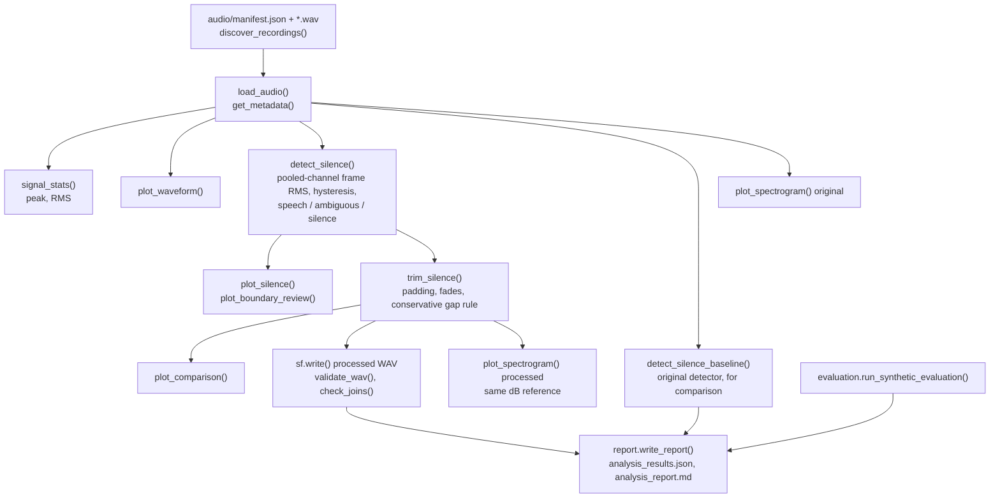

# Voice Signal Analysis and Silence Removal Using Python

Course project for **EC24313 – Artificial Intelligence and Machine Learning** (Assignment 1).

This project applies basic digital signal processing to two recorded speech samples (declared as "BIT" and "Naman Gupta"). It extracts audio metadata, plots time-domain waveforms, detects silent regions with a hysteresis short-time-energy detector, trims silence conservatively, and produces STFT spectrograms. The detector is evaluated against the original single-threshold detector on synthetic signals with known ground truth. Figures, processed audio, a JSON file of measurements and a Markdown report are generated by one command.

It is an educational signal-processing exercise. It is not a speech recognition or speaker identification system, and no recognition experiments were performed.

## Motivation

- Speech is stored as discrete amplitude samples taken at a fixed sampling frequency. The raw file does not show where the speech starts and stops.
- Leading and trailing silence lengthens a recording and adds uninformative data for later stages (feature extraction, voice activity analysis).
- Deciding which low-energy parts are silence is not trivial: background noise, breath, soft consonants and quiet voiced sounds all have low amplitude.
- A spectrogram shows how frequency content changes with time, which a waveform cannot.

## Objectives

1. Load the recordings and extract metadata (sampling frequency, channels, samples, duration) and peak/RMS amplitude.
2. Plot the time-domain waveform.
3. Detect and annotate leading, trailing and internal silence, and flag uncertain low-level regions instead of deleting them.
4. Trim silence conservatively and compare original and processed signals.
5. Generate spectrograms of the original and processed audio.
6. Quantify detector behaviour on synthetic signals and validate the processed files.
7. Export processed WAV files, plots, `analysis_results.json` and `analysis_report.md`.

## Workflow



| Stage | Input | Processing | Output |
|---|---|---|---|
| Discovery and loading | `audio/` (+ `manifest.json`) | `soundfile` reads float64 samples shaped `(N, channels)`; sampling frequency comes from the WAV header | samples, `fs`, metadata, declared utterance |
| Statistics | samples | peak = max abs value; RMS over all channels | amplitudes (full scale = 1.0) |
| Silence detection | all channels | pooled frame RMS (dB), robust noise floor, hysteresis thresholds | speech, ambiguous and silent intervals |
| Trimming | original samples + intervals | cut leading/trailing silence with padding; shorten only qualifying long gaps; fades at every cut | processed samples |
| Validation | saved WAV | re-read and compare with the processed array and metadata; check joins and original-file hash | pass/fail per check |
| Spectrogram | mono mix | Hann-window STFT power, dB relative to the original's peak | PNG figures |
| Synthetic evaluation | generated test signals | both detectors vs. known truth | F1, boundary error, preserved-speech fraction |

## Methodology

### Audio representation

Samples are amplitude values normalised to ±1. For `N` samples per channel and sampling frequency `f_s`, the duration is

$$T = \frac{N}{f_s}$$

The sampling frequency is read from the WAV header (`soundfile.info`); it is the number of samples per second and is unrelated to the pitch of the voice. Both recordings are stereo; plots show both channels and the detector pools energy over both channels (a plain channel average would cancel out-of-phase channels).

### Silence detection (`detect_silence`)

1. Frame RMS in dB over **25 ms frames with a 10 ms hop**, pooled over all channels. Each frame owns the hop-sized span around its centre, so boundaries are not delayed by half a frame.
2. **Noise floor** = median of the quietest 10 % of frames after excluding digital-zero frames (< −90 dBFS; they carry no noise information). **Speech level** = 95th percentile.
3. **Hysteresis:** low (hold) threshold = noise + 8 dB; high (onset) threshold = noise + 20 dB, kept at least 10 dB below the speech level.
4. Frames above the low threshold form runs; dips shorter than 100 ms are bridged and runs shorter than 30 ms are dropped.
5. A run is confident **speech** where it has at least 30 ms above the high threshold, extended by at most 150 ms beyond that core (soft onsets/decays). Remaining low-level activity is **ambiguous** (breath, noise or weak speech) and is preserved by default.
6. If the speech level is less than 15 dB above the noise floor, no region is declared silent.

Everything is based on amplitude. It does not identify words or phonemes. Spectral flux, zero-crossing rate and spectral centroid were inspected on the real recordings and did not separate low-frequency noise from weak voiced sound reliably, so they are not used.

The original detector (single threshold `max(P10 + 12 dB, P95 − 35 dB)` on the channel average) is kept as `detect_silence_baseline` and its results are frozen in `outputs/baseline_results.json`; a test checks that it still reproduces them.

### Silence removal (`trim_silence`)

- Leading and trailing silence is cut, keeping **100 ms** of padding around the first and last active (speech or ambiguous) region, with a 5 ms fade at every cut that is not the file's own edge.
- An internal gap is shortened (to 200 ms) **only if it is longer than 400 ms and both neighbours are confident speech**. In both recordings no gap qualified, so no internal gap was changed.
- The sampling frequency, channels and 16-bit PCM format are retained; no gain is applied. Inputs are never modified.

### Spectrogram (`compute_spectrogram`, `plot_spectrogram`)

$$X(m,k)=\sum_{n=0}^{N-1}x[n+mH]\,w[n]\,e^{-j2\pi kn/N}$$

`w[n]` is a Hann window, `N = 1024`, hop `H = 128` (at 48 kHz: 21.3 ms window, 2.7 ms hop, 46.9 Hz bin spacing). 0 dB is the peak power of the **original** recording, and the processed spectrogram uses the same reference. The axis stops at 8 kHz (or Nyquist if lower). `outputs/plots/*_spectrogram_resolution.png` compares 512/1024/2048-point windows; 1024 was kept as a compromise judged by inspection. Individual harmonics or formants of a 1–2 s utterance should not be over-interpreted.

## Results

Values come from `outputs/analysis_results.json`. Amplitudes are relative to full scale.

### "BIT" (`audio/Naman_BIT.wav`)

| Metric | Original | Processed |
|---|---|---|
| Sampling frequency | 48 000 Hz | 48 000 Hz |
| Channels | 2 | 2 |
| Samples per channel | 118 656 | 102 720 |
| Duration | 2.472 s | 2.140 s |
| Peak amplitude | 0.9523 | 0.9523 |
| RMS amplitude | 0.1615 | 0.1736 |

Removed: 0.332 s (**13.4 %**; the original detector gave 14.6 %). Detected regions: silence 0–0.158 s, **ambiguous 0.158–0.608 s**, speech 0.608–1.718 s, internal silence 1.718–1.817 s, speech 1.817–2.098 s, trailing silence 2.098–2.472 s.

### "Naman Gupta" (`audio/Naman_Name.wav`)

| Metric | Original | Processed |
|---|---|---|
| Sampling frequency | 48 000 Hz | 48 000 Hz |
| Channels | 2 | 2 |
| Samples per channel | 87 552 | 84 792 |
| Duration | 1.824 s | 1.7665 s |
| Peak amplitude | 0.9477 | 0.9477 |
| RMS amplitude | 0.1666 | 0.1693 |

Removed: 0.0575 s (**3.2 %**; the original detector gave 13.3 %). Detected regions: silence 0–0.158 s, ambiguous 0.158–0.287 s, speech 0.287–1.347 s, internal silence 1.347–1.528 s, **ambiguous 1.528–1.824 s**.

### What changed relative to the original detector

For "Naman Gupta" the original detector reported leading silence up to 0.343 s and internal silence at 1.053–1.153 s and 1.333–1.693 s, and trimmed 0.2425 s from the start. The new detector keeps the low-level start (0.158–0.287 s, ambiguous) and the 0.3 s tail (1.528–1.824 s, ambiguous), because the plots cannot show they are non-speech, so it removes only 0.0575 s. The lower reduction is a deliberate consequence of the conservative policy, not a quality score.

Only the two ends were trimmed (0.0575 s from the start of each file; the "BIT" file also loses 0.275 s of trailing silence). Processed RMS is slightly higher because low-energy frames were removed from the average; peak amplitude is unchanged. Both processed files passed all 12 integrity checks (reopens, non-empty, finite, non-zero, same sampling frequency/channels/sample count, matches the processed array within 1 LSB, no clipped samples, peak not above the original, joins, original file hash unchanged). These are signal-integrity checks; intelligibility was not assessed by listening.

### Synthetic evaluation (known ground truth)

`evaluation.py` generates deterministic speech-like test signals (harmonic bursts plus filtered noise, 16 kHz). Selected results from `outputs/analysis_report.md` (frame-level F1 on a 10 ms grid; "preserved" = fraction of true speech samples kept after trimming):

| Scenario | Baseline F1 | Improved F1 | Baseline preserved | Improved preserved |
|---|---|---|---|---|
| clean | 0.99 | 0.99 | 1.000 | 1.000 |
| SNR 20 dB | 1.00 | 1.00 | 1.000 | 1.000 |
| SNR 10 dB | 0.00 | 0.64 | 1.000 | 1.000 |
| speech fills almost the whole file | 0.48 | 1.00 | 0.981 | 1.000 |
| channels with opposite polarity | 0.00 | 0.99 | 1.000 | 1.000 |
| 300 ms noise burst in silence | 0.86 | 0.86 | 1.000 | 1.000 |

At 10 dB SNR the improved detector cannot separate speech from noise and trims nothing (its F1 reflects marking everything ambiguous). A loud click or noise burst inside silence is treated as activity by both detectors. No F1 is reported for the real recordings because no labelled ground truth exists for them.

## Figures

### Original waveform – "BIT"


Amplitude (full scale = 1) versus time for the left and right channels. The speech appears as bursts near 0.9–1.3 s, 1.35–1.7 s and 1.85–2.1 s; the flat start is digital silence before low-level noise begins.

### Silence detection – "BIT"


Top: waveform with confident speech shaded green, ambiguous low-level activity orange and silence red. Bottom: frame RMS in dBFS with the noise floor and the two hysteresis thresholds.

### Boundary review – "BIT"


Zoomed views of the start and end: waveform, frame RMS and spectrogram. The ambiguous region before the first vowel contains isolated impulsive spikes (a vertical broadband line near 0.26 s) and no harmonic stripes, which suggests clicks or breath, but this cannot be proven from the plots, so it is kept. The end of the recording decays smoothly to a flat noise floor.

### Before and after – "Naman Gupta"


Original (top) and processed (bottom) share the same time and amplitude axes. Only 0.0575 s was removed from the start; the low-level tail is intentionally preserved.

### Spectrogram – "BIT"


Time (s) on the x-axis, frequency (Hz) on the y-axis, colour = power in dB relative to the peak of this recording. Voiced sounds appear as horizontal harmonic stripes spaced at the pitch, vowel formants as broad bright bands, and plosive bursts as vertical broadband lines.

### Boundary review and spectrogram – "Naman Gupta"


The 1.53–1.82 s tail has energy mostly below about 300 Hz and no word-like harmonic structure; it is the main unresolved uncertainty. Other plots (`*_waveform.png`, `*_silence_detection.png`, `*_trimmed_waveform.png`, `*_spectrogram_processed.png`, `*_spectrogram_resolution.png`) are in `outputs/plots/`.

## Technology stack

From `requirements.txt` and the imports:

- **Python** – developed and run on Python 3.13 (uses `X | None` annotations, so 3.10 or newer is needed).
- **NumPy** – frame energy, statistics, trimming.
- **SoundFile** – WAV reading, metadata and writing.
- **SciPy** – `scipy.signal.spectrogram` (STFT) and a filter in the synthetic noise generator.
- **Matplotlib** – all figures (Agg backend, 250 DPI).
- **pytest** – tests.

Librosa is not used.

## Repository structure

```
.
├── assignment1.py            # pipeline: loading, detectors, trimming, validation, plots, CLI
├── evaluation.py             # synthetic ground-truth evaluation (testing only)
├── report.py                 # generates outputs/analysis_report.md
├── manual_review.json        # analyst's visual boundary observations (included in the report)
├── requirements.txt
├── audio/
│   ├── Naman_BIT.wav         # original recording (never modified)
│   ├── Naman_Name.wav        # original recording (never modified)
│   └── manifest.json         # declared utterance for each file
├── tests/
│   └── test_assignment1.py
└── outputs/
    ├── analysis_results.json
    ├── analysis_report.md
    ├── baseline_results.json # frozen results of the original detector (kept for comparison)
    ├── plots/
    └── processed_audio/
```

## Installation and usage

Requires Python 3.10+.

```powershell
python -m venv .venv
.\.venv\Scripts\Activate.ps1
pip install -r requirements.txt
python assignment1.py
python -m pytest tests -q
```

On Linux/macOS activate with `source .venv/bin/activate`. Run from the repository root. Optional arguments: `--audio-dir DIR` and `--output-dir DIR`. Recordings are identified through `audio/manifest.json`; without it the script falls back to filename keywords (`bit`; `name`/`gupta`). Exit status is 0 on success, 1 on a critical error and 2 if a processed file fails validation. Reruns overwrite generated files only (`outputs/baseline_results.json` is not regenerated).

All detector, trimming and spectrogram parameters are fields of the `Config` dataclass in `assignment1.py`; `trim_ambiguous=True` would also remove ambiguous regions (not the default).

## Output reference

| Artifact | Path | Purpose |
|---|---|---|
| Waveform | `outputs/plots/{bit,name}_waveform.png` | amplitude vs. time |
| Silence detection | `outputs/plots/{bit,name}_silence_detection.png` | classified regions, frame RMS, thresholds |
| Boundary review | `outputs/plots/{bit,name}_boundary_review.png` | zoomed start/end with waveform, RMS and spectrogram |
| Original vs. processed | `outputs/plots/{bit,name}_trimmed_waveform.png` | before/after on the same axes |
| Spectrograms | `outputs/plots/*_spectrogram.png`, `*_spectrogram_processed.png`, `*_spectrogram_resolution.png` | frequency content over time; FFT-size comparison |
| Processed audio | `outputs/processed_audio/*_processed.wav` | trimmed recordings |
| Results | `outputs/analysis_results.json` | measurements, parameters, intervals, baseline comparison, validation, synthetic evaluation |
| Frozen baseline | `outputs/baseline_results.json` | original detector's results |
| Report | `outputs/analysis_report.md` | write-up of the same results |

Source recordings are in `audio/`; everything in `outputs/` except `baseline_results.json` can be regenerated.

## Limitations

- Detection is energy-based. Loud non-speech sounds (clicks, noise bursts) look like speech, and very quiet speech near the noise floor may be labelled ambiguous or, at worst, silence.
- The noise floor assumes the quietest frames are representative background noise; a recording with no noise-only frames would break this, and the minimum-separation guard only partly mitigates it.
- Ambiguous regions (the 0.16–0.61 s lead-in of "BIT" and the 1.53–1.82 s tail of "Naman Gupta", among others) are preserved because the evidence cannot separate breath, noise and weak speech. A listening check is still needed.
- The declared utterance of each file comes from `audio/manifest.json`; no speech recognition was run, so spoken content is not verified.
- The manual boundary observations come from plots, not listening, and are not ground truth. Join checks measure sample discontinuities, not audibility.
- Synthetic results show behaviour on simplified signals and need not transfer to all recordings.
- Spectrogram appearance depends on window length, hop and dB range. No recognition accuracy or other downstream benefit is claimed.

## Conclusion

Both 48 kHz stereo recordings were analysed with a hysteresis detector that preserves speech in every synthetic scenario tested and fixes two failure cases of the original (little silence, opposite-polarity channels). On the real recordings only confidently identified silence was removed (13.4 % of "BIT", 3.2 % of "Naman Gupta"), with uncertain low-level regions flagged and kept.
