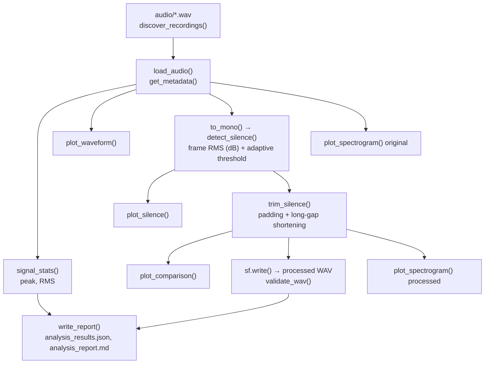

# Voice Signal Analysis and Silence Removal Using Python

Course project for **EC24313 – Artificial Intelligence and Machine Learning** (Assignment 1).

This project applies basic digital signal processing to two recorded speech samples ("BIT" and "Naman Gupta"). It extracts audio metadata, plots time-domain waveforms, detects silent regions with a short-time energy method, trims silence conservatively, and produces STFT spectrograms. All figures, processed audio, a JSON file of measurements and a Markdown report are generated by one script.

It is an educational signal-processing exercise. It is not a speech recognition or speaker identification system, and no recognition experiments were performed.

## Motivation

- Speech is stored as discrete amplitude samples taken at a fixed sampling frequency. The raw file does not show where the speech starts and stops.
- Leading and trailing silence lengthens a recording and adds uninformative data for later processing stages (e.g. feature extraction in speech pipelines, voice activity analysis).
- The time-domain waveform shows amplitude, duration and activity, but deciding which low-energy parts are silence is not trivial: background noise, soft consonants and quiet voiced sounds all have low amplitude.
- A spectrogram shows how frequency content changes with time, which a waveform cannot.

## Objectives

1. Load the recordings and extract metadata (sampling frequency, channels, samples, duration).
2. Compute peak and RMS amplitude.
3. Plot the time-domain waveform.
4. Detect and annotate leading, trailing and internal silent regions.
5. Trim silence conservatively while preserving speech.
6. Compare original and processed signals on identical axes.
7. Generate STFT spectrograms of the original and processed audio.
8. Export processed WAV files, plots, `analysis_results.json` and `analysis_report.md`.

## Workflow



| Stage | Input | Processing | Output |
|---|---|---|---|
| Discovery and loading | `audio/` | `soundfile` reads samples as float64, shape `(N, channels)`; sampling frequency comes from the WAV header | samples, `fs`, metadata |
| Statistics | samples | peak = max abs value; RMS = √mean(x²) over all channels | amplitudes (full scale = 1.0) |
| Silence detection | mono mix (channel average) | frame RMS in dB, adaptive threshold, minimum durations | silent and speech intervals |
| Trimming | original samples + intervals | cut leading/trailing silence with padding; shorten very long internal gaps; short fades at joins | processed samples |
| Validation | saved processed WAV | re-read and check non-empty, finite, non-zero, same `fs`/channels/sample count, no clipping | pass/fail per check |
| Spectrogram | mono mix | Hann-window STFT power, shared dB scale | PNG figures |

## Methodology

### Audio representation

Samples are amplitude values normalised to ±1. For `N` samples per channel and sampling frequency `f_s`, the duration is

$$T = \frac{N}{f_s}$$

The sampling frequency is read from the WAV header (`soundfile.info`); it is the number of samples per second and has nothing to do with the pitch (fundamental frequency) of the voice. Both recordings are stereo, so the plots show both channels while the analysis uses their average.

### Silence detection (`detect_silence`)

1. Compute RMS energy in dB over **25 ms frames with a 10 ms hop**.
2. Estimate the **noise floor** as the 10th percentile and the **speech level** as the 95th percentile of the frame levels of that recording.
3. Threshold = max(noise floor + 12 dB, speech level − 35 dB). It therefore adapts to each file (≈ −32.5 dB for both recordings here).
4. Frames above the threshold are active. Low-energy runs shorter than **100 ms** inside the recording are treated as pauses within speech (not silence), and active runs shorter than **30 ms** are discarded as noise bursts.
5. Remaining low-energy runs become silent regions, labelled leading, trailing or internal.

This is an amplitude-based decision only. It does not identify words or phonemes.

### Silence removal (`trim_silence`)

- Leading and trailing silence is cut, keeping **100 ms** of padding around the first and last active region.
- Internal gaps are **shortened to 200 ms only if longer than 400 ms**, with 5 ms fades at the join. Shorter gaps are left alone because they are natural pauses and stop closures. For these recordings no internal gap exceeded 400 ms, so **no internal gap was removed**; the reduction comes from the ends only.
- The sampling frequency, channels and 16-bit PCM format are retained; no gain is applied. The input arrays are never modified.

### Spectrogram (`compute_spectrogram`, `plot_spectrogram`)

The Short-Time Fourier Transform is

$$X(m,k)=\sum_{n=0}^{N-1}x[n+mH]\,w[n]\,e^{-j2\pi kn/N}$$

with `w[n]` a Hann window, `N = 1024` samples, hop `H = 128` samples (at 48 kHz: 21.3 ms window, 2.7 ms hop, 46.9 Hz bin spacing). Power is shown in dB relative to the peak of the plotted file, with an 80 dB range, up to 8 kHz. Window length trades time resolution against frequency resolution. For short inputs the window is reduced to fit.

## Results

All values below come from `outputs/analysis_results.json`. Amplitudes are relative to full scale (1.0).

### "BIT" (`audio/Naman_BIT.wav`)

| Metric | Original | Processed |
|---|---|---|
| Sampling frequency | 48 000 Hz | 48 000 Hz |
| Channels | 2 | 2 |
| Samples per channel | 118 656 | 101 280 |
| Duration | 2.472 s | 2.110 s |
| Peak amplitude | 0.9523 | 0.9523 |
| RMS amplitude | 0.1615 | 0.1748 |

Removed: 0.362 s (**14.6 %**). Detected silence: leading 0–0.183 s, internal 0.473–0.723 s and 1.713–1.823 s, trailing 2.093–2.472 s.

### "Naman Gupta" (`audio/Naman_Name.wav`)

| Metric | Original | Processed |
|---|---|---|
| Sampling frequency | 48 000 Hz | 48 000 Hz |
| Channels | 2 | 2 |
| Samples per channel | 87 552 | 75 912 |
| Duration | 1.824 s | 1.5815 s |
| Peak amplitude | 0.9477 | 0.9477 |
| RMS amplitude | 0.1666 | 0.1789 |

Removed: 0.2425 s (**13.3 %**). Detected silence: leading 0–0.343 s, internal 1.053–1.153 s and 1.333–1.693 s. No trailing silence was detected: the final ~0.13 s is low-level noise just above the threshold and is classed as active.

The RMS rises slightly because low-energy frames were removed from the average; peak amplitude is unchanged. Both processed files passed all validation checks (non-empty, finite, non-zero, same sampling frequency/channels/sample count, no clipping).

## Figures

### Original waveform – "BIT"


Amplitude (full scale = 1) versus time in seconds for the left and right channels. The speech shows as three bursts near 0.9–1.3 s, 1.35–1.7 s and 1.85–2.1 s; the flat start is digital silence before low-level noise begins.

### Silence detection – "BIT"


Top: waveform with silent regions shaded red and active (speech) regions shaded green. Bottom: frame RMS in dBFS with the adaptive threshold and the estimated noise floor. Active regions include low-level sounds before the main vowel that sit above the threshold; this is a limitation of an energy-only rule.

### Before and after – "Naman Gupta"


Original (top) and processed (bottom) share the same amplitude limits and the same time axis, so the shortened start is directly visible. The speech content is unchanged; 0.2425 s was removed from the start.

### Spectrogram – "BIT"


Time (s) on the x-axis, frequency (Hz) on the y-axis, colour = power in dB relative to the peak. Voiced sounds appear as horizontal harmonic stripes spaced at the pitch, vowel formants as broad bright bands, and the plosive bursts as vertical broadband lines.

### Silence detection and spectrogram – "Naman Gupta"


The remaining plots (`*_waveform.png` for Name, `*_trimmed_waveform.png` for BIT, `*_spectrogram_processed.png`) are in `outputs/plots/`.

## Technology stack

From `requirements.txt` and the imports in `assignment1.py`:

- **Python** – developed and run on Python 3.13 (uses `X | None` type syntax, so 3.10 or newer is needed).
- **NumPy** – frame windows, statistics, trimming.
- **SoundFile** – WAV reading, metadata and writing.
- **SciPy** – `scipy.signal.spectrogram` (STFT).
- **Matplotlib** – all figures (Agg backend, 250 DPI).
- **pytest** – tests.

Librosa is not used.

## Repository structure

```
.
├── assignment1.py            # entire pipeline (functions + CLI entry point)
├── requirements.txt
├── audio/
│   ├── Naman_BIT.wav         # original recording (never modified)
│   └── Naman_Name.wav        # original recording (never modified)
├── tests/
│   └── test_assignment1.py   # unit and pipeline tests (synthetic signals only)
└── outputs/                  # generated
    ├── analysis_results.json
    ├── analysis_report.md
    ├── plots/                # PNG figures
    └── processed_audio/      # trimmed WAV files
```

## Installation and usage

Requires Python 3.10+.

```powershell
python -m venv .venv
.\.venv\Scripts\Activate.ps1
pip install -r requirements.txt
python assignment1.py
python -m pytest tests -q
```

On Linux/macOS activate with `source .venv/bin/activate`. Run commands from the repository root. Optional arguments: `--audio-dir DIR` and `--output-dir DIR` (defaults: `audio/` and `outputs/` next to the script). The script finds one file whose name contains `bit` and one containing `name`, `naman_gupta` or `gupta`. Exit status is 0 on success, 1 on a critical error and 2 if a processed file fails validation. Reruns overwrite generated files only.

Detection and trimming parameters (frame/hop length, percentiles, margins, minimum durations, padding, gap limits, spectrogram settings) are fields of the `Config` dataclass at the top of `assignment1.py`.

## Output reference

| Artifact | Path | Purpose |
|---|---|---|
| Waveform | `outputs/plots/{bit,name}_waveform.png` | amplitude vs. time |
| Silence detection | `outputs/plots/{bit,name}_silence_detection.png` | shaded silent/speech regions, frame RMS and threshold |
| Original vs. processed | `outputs/plots/{bit,name}_trimmed_waveform.png` | before/after on the same axes |
| Spectrograms | `outputs/plots/{bit,name}_spectrogram.png`, `*_spectrogram_processed.png` | frequency content over time |
| Processed audio | `outputs/processed_audio/*_processed.wav` | trimmed recordings |
| Results | `outputs/analysis_results.json` | measurements, parameters, intervals, validation |
| Report | `outputs/analysis_report.md` | generated write-up of the same results |

Source recordings are in `audio/`; everything in `outputs/` is derived and can be regenerated.

## Limitations

- Energy-based detection can mistake quiet speech for silence, and low-level noise or breath near the threshold for speech (visible at the end of the "Naman Gupta" recording and before the first vowel of "BIT"). Results depend on the percentile-based threshold and the recording conditions.
- Percentile estimates assume each file contains both background and speech frames.
- Which phrase each file contains is taken from its filename; it was not verified automatically, and intelligibility of the processed audio was not assessed by a listening test.
- Spectrogram appearance depends on the window length, hop, window function and dB range.
- No recognition accuracy or other downstream benefit is claimed.

## Conclusion

The pipeline analysed both 48 kHz stereo recordings, located the silent regions, shortened the recordings by 14.6 % ("BIT") and 13.3 % ("Naman Gupta") by trimming their ends, and produced waveform, comparison and spectrogram figures together with machine-readable results.
