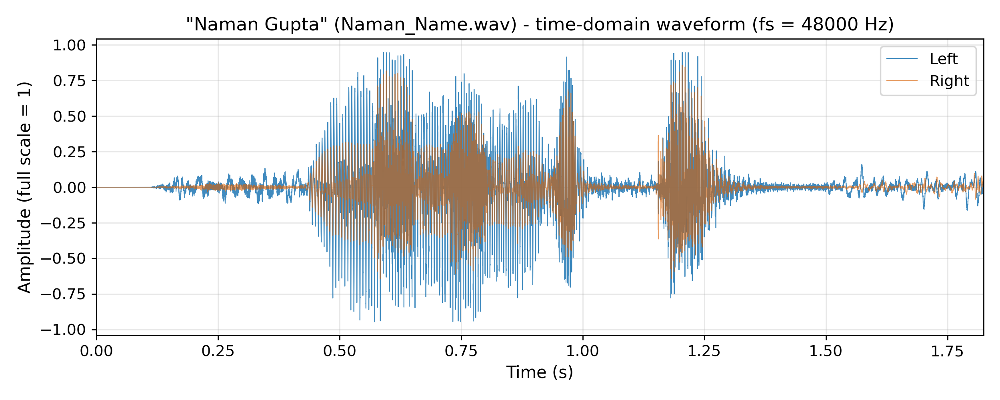
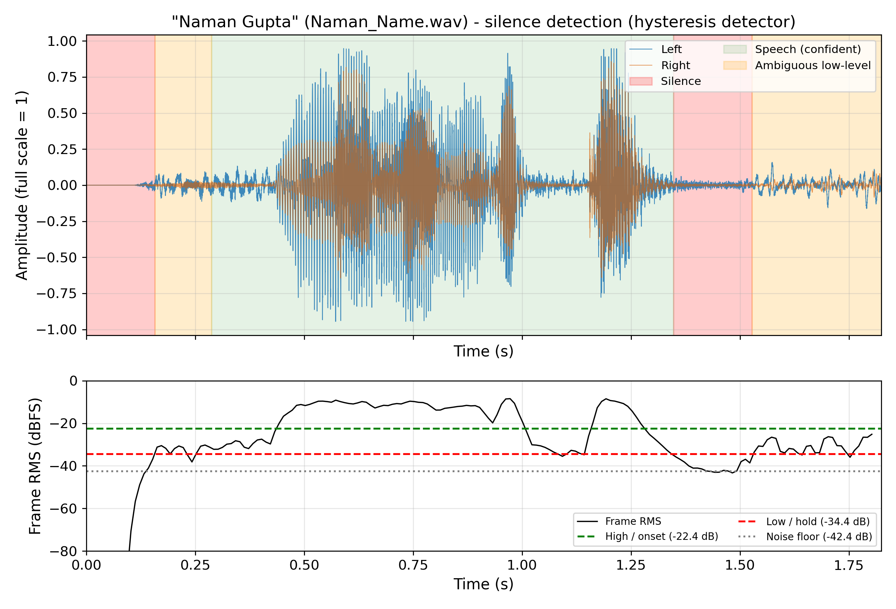
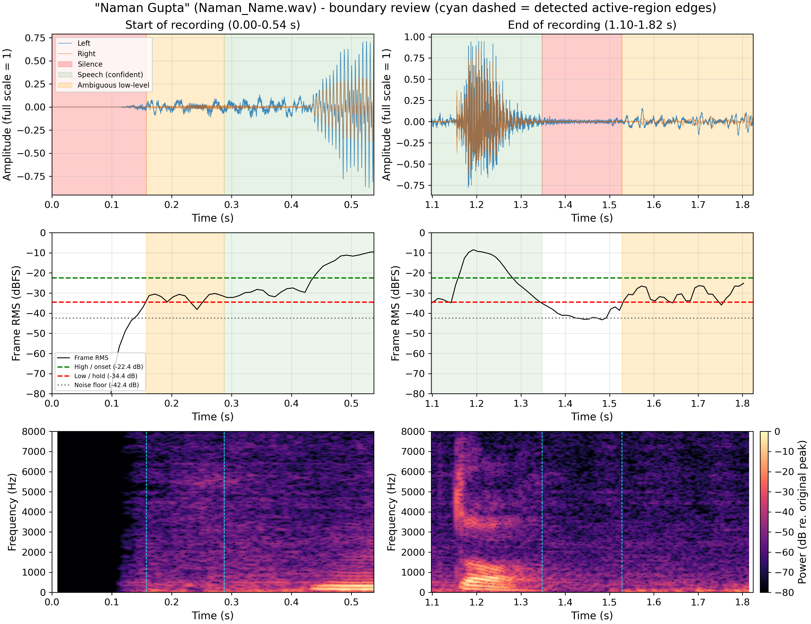
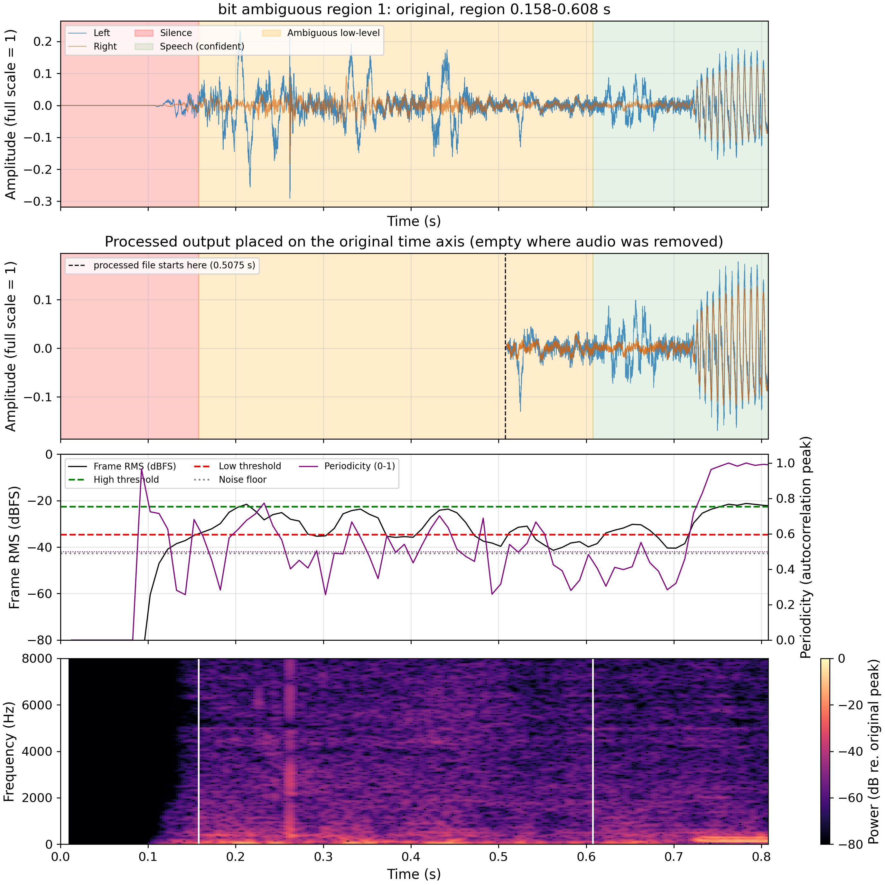
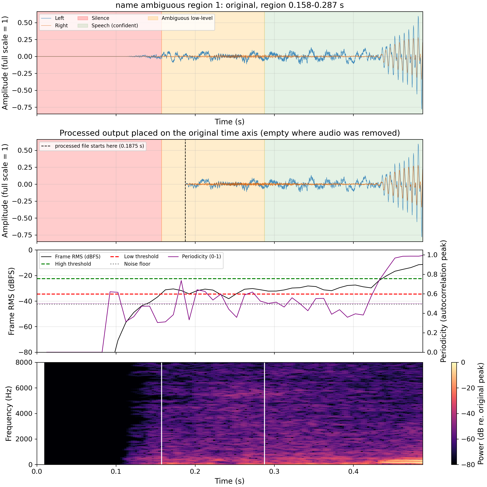
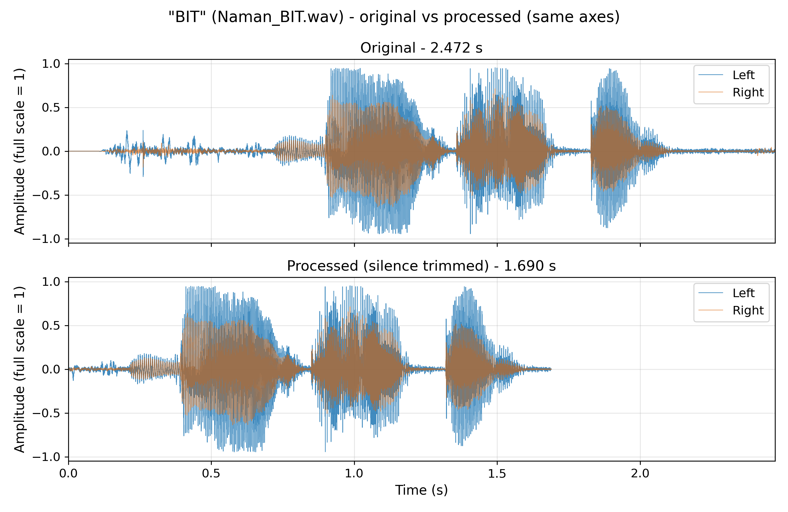
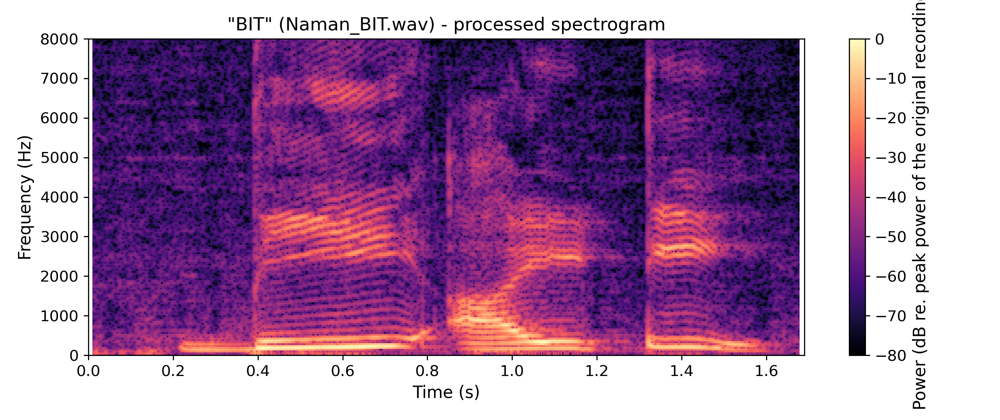
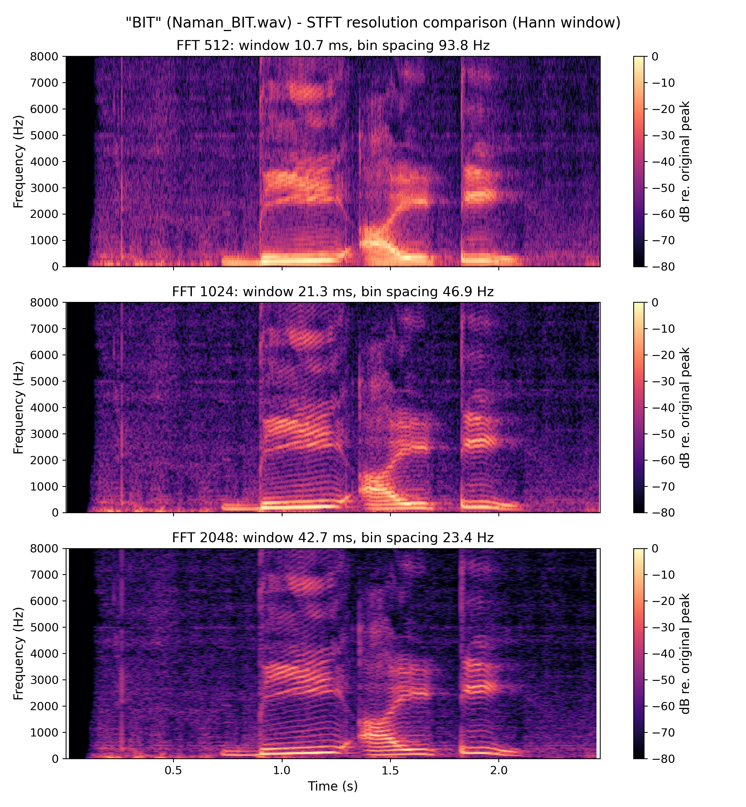
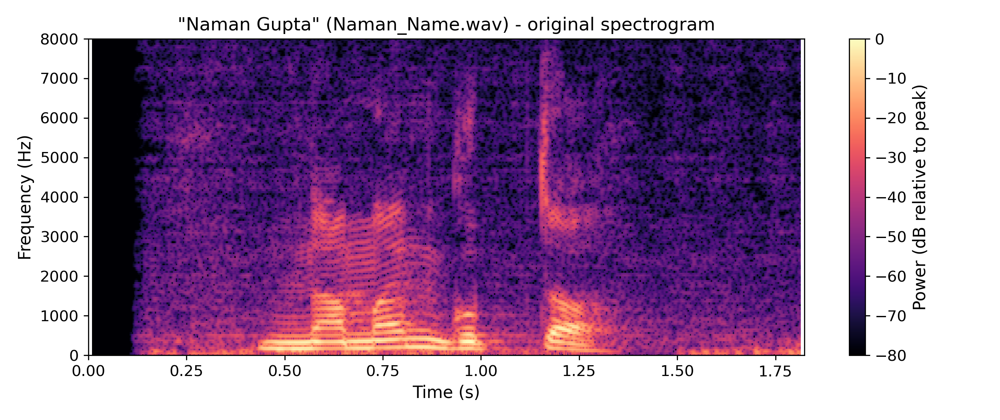
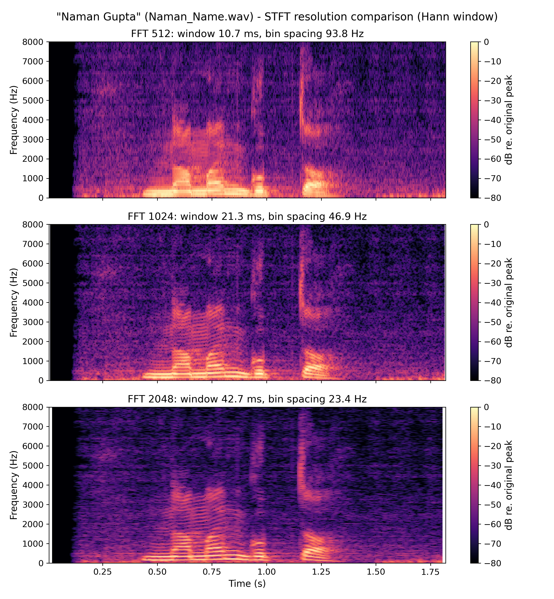

# EC24313 Artificial Intelligence and Machine Learning - Assignment 1

**Course:** EC24313 - Artificial Intelligence and Machine Learning  
**Student:** Naman Gupta  
**Topic:** Voice recording, time-domain analysis, silence detection/removal and spectrogram

Every number below was produced by `python assignment1.py` from the actual recordings, or (where labelled *synthetic*) from deterministic test signals with known ground truth. Each kind of evidence is labelled:

| Evidence class | Where it appears | What it can and cannot show |
|---|---|---|
| **Measured** (automatic, real recordings) | Sections 4, 5.1-5.2, 5.4, 6, 7 | Durations, levels, detected regions; no ground truth for speech/non-speech |
| **Recognition-based** (offline ASR, real recordings) | Section 3.1 | Supporting evidence for the declared utterance; not ground truth |
| **Automated region evidence** (features, real recordings) | Section 5.3 | Describes ambiguous regions; cannot identify speech |
| **Manual observation** (plots inspected by the analyst) | Section 5.3 | Judgement from images; not a listening test |
| **Manual listening** | Section 5.3 (only if `manual_listening.json` exists) | Human listening results, if provided |
| **Synthetic** (generated signals, known truth) | Sections 5.5, 6.2, 8 | Algorithm behaviour on simplified signals only |
| **Assumptions / unverified** | Section 10 | Listed explicitly |

## 1. Objective

To study two short utterances (declared as "BIT" and "Naman Gupta") in the time domain, locate silent regions with a robust detector, produce conservatively trimmed versions, and examine the time-frequency content with a spectrogram. Priority order: do not remove genuine speech; preserve soft onsets/decays; remove only confidently identified silence; preserve ambiguous low-level regions.

## 2. Tools and Libraries

Python, NumPy (frame energy, statistics), SoundFile (WAV I/O and header metadata), SciPy (STFT), Matplotlib (plots), pytest (tests). Optional, only for `verify_content.py`: faster-whisper with a locally cached model and the Windows built-in System.Speech recogniser. CPU only; audio is never uploaded.

## 3. Methodology

1. **Identity:** each file is tied to its declared utterance through `audio/manifest.json` (a declaration), then cross-checked with offline speech recognition where available (Section 3.1).
2. **Time domain:** header metadata (sampling frequency, channels, samples), peak and RMS, waveform plots.
3. **Silence detection:** hysteresis energy detector (Section 5) compared with the original single-threshold baseline.
4. **Trimming:** boundary trimming with padding; ambiguous regions are removed (`trim_ambiguous` = True; Section 6).
5. **Validation:** re-open each processed file and check integrity, join discontinuities and original-file hashes.
6. **Spectrogram:** Hann-window STFT, shared dB reference (Section 7).

### 3.1 Verification of spoken content (recognition-based evidence)

Recognition output is supporting evidence only, not ground truth. Audio stays on this machine. Command: `python verify_content.py`. Audio was converted to 16 kHz mono in a temporary directory (originals untouched). Comparison ignores case and punctuation (`B-I-T` = `bit`); a similarity of at least 0.8 counts as consistent.

| Recording | Declared | Engine | Transcript | Similarity | Consistent? | Engine confidence |
|---|---|---|---|---|---|---|
| bit | BIT | faster-whisper (offline, CPU, int8) | "BIT" | 1.00 | yes | avg log-prob [-0.709] |
| bit | BIT | Windows System.Speech dictation (offline, en-US) | "The FBI B" | 0.40 | no | confidence [0.023] |
| name | Naman Gupta | faster-whisper (offline, CPU, int8) | "Naman Gupta" | 1.00 | yes | avg log-prob [-0.373] |
| name | Naman Gupta | Windows System.Speech dictation (offline, en-US) | "Non little" | 0.32 | no | confidence [0.096] |

- **bit**: status `partially_supported` - 1 of 2 engines agree; the others disagreed or returned low-confidence text. Treat as unverified until listened to. Confidence: limited: very short recordings, few engines, no ground-truth transcript.
- **name**: status `partially_supported` - 1 of 2 engines agree; the others disagreed or returned low-confidence text. Treat as unverified until listened to. Confidence: limited: very short recordings, few engines, no ground-truth transcript.

The Whisper model is a local copy; the Windows dictation engine is a weak recogniser for single short words, so its disagreement is weak evidence against the declared utterance, and Whisper's agreement is not proof. **Manual verification procedure:** (1) Play the original file (not the processed one) with headphones. (2) Write down exactly what you hear, once, without looking at the expected phrase. (3) Compare with the declared utterance in audio/manifest.json and record the result in manual_listening.json. (4) A second listener makes the check more reliable.

## 4. Sampling Frequency and Time-Domain Analysis

The sampling frequency is the number of amplitude samples stored per second. It is read from the WAV header (`soundfile.info`), not estimated from the signal, and it is unrelated to the speaker's fundamental frequency (pitch, typically ~85-255 Hz for adults). Duration = samples / fs. The Nyquist limit fs/2 is the highest representable frequency. Both files are stereo; plots show both channels and the detector pools energy over both channels.

| Recording | Declared utterance | File | fs (Hz) | Channels | Samples | Duration (s) | Peak | RMS |
|---|---|---|---|---|---|---|---|---|
| bit | BIT | Naman_BIT.wav | 48000 | 2 | 118656 | 2.472 | 0.9523 | 0.1615 |
| name | Naman Gupta | Naman_Name.wav | 48000 | 2 | 87552 | 1.824 | 0.9477 | 0.1666 |

## 5. Silent Region Identification

### 5.1 Baseline detector (original implementation)

Mono mix, 25 ms frames / 10 ms hop, threshold = max(P10 + 12 dB, P95 - 35 dB), pauses < 100 ms bridged, runs < 30 ms dropped. Weaknesses examined: the noise floor is a percentile of the same frames being classified (biased when little silence exists), channel averaging can cancel out-of-phase channels, and a single threshold has no way to express uncertainty.

### 5.2 Improved detector (default)

- Frame RMS in dB over **all channels pooled** (25 ms frames, 10 ms hop; each frame owns the hop-sized span around its centre, so onsets are not delayed by half a frame).
- **Noise floor** = median of the quietest 10 % of frames after excluding digital-zero frames (< -90 dBFS, which carry no noise information). The MAD of those frames is reported as a stationarity check only; using it to set thresholds pushed the threshold into soft speech on the real recordings and was rejected.
- **Hysteresis:** low (hold) threshold = noise + 8 dB; high (onset) threshold = noise + 20 dB, kept at least 10 dB below the speech level (95th percentile).
- Confident **speech** needs >= 30 ms above the high threshold and extends at most 150 ms beyond that core. Other low-level activity above the hold threshold is **ambiguous** (breath, noise or weak speech); whether it is removed is controlled by `trim_ambiguous`.
- Pauses shorter than 100 ms are bridged; active runs shorter than 30 ms are discarded.
- If speech level - noise floor < 15 dB, no region is declared silent.
- **Periodicity gate** (`use_periodicity_gate` = True): a high-energy cluster is accepted as confident speech only if it contains at least 30 ms of frames whose normalised autocorrelation peak (70-400 Hz lags, 40 ms window) is >= 0.5; otherwise it is labelled ambiguous. Evaluated in Section 5.5. It detects voicing, not speech.
- Zero-crossing rate, spectral flux, spectral flatness and low-frequency energy fraction were also measured on controlled signals (Section 5.5) and were not adopted.

| Recording | Noise floor (dB) | MAD (dB) | Low thr. (dB) | High thr. (dB) | Speech level (dB) | Level - noise (dB) |
|---|---|---|---|---|---|---|
| bit | -42.6 | 1.1 | -34.6 | -22.6 | -9.6 | 33.0 |
| name | -42.4 | 1.4 | -34.4 | -22.4 | -9.7 | 32.7 |

**bit (BIT) - improved detector**

| Type | Start (s) | End (s) | Duration (s) |
|---|---|---|---|
| leading | 0.000 | 0.158 | 0.158 |
| ambiguous | 0.158 | 0.608 | 0.450 |
| speech | 0.608 | 1.718 | 1.110 |
| internal | 1.718 | 1.817 | 0.100 |
| speech | 1.817 | 2.098 | 0.280 |
| trailing | 2.098 | 2.472 | 0.374 |

Baseline silence intervals for comparison: leading 0.000-0.182 s; internal 0.472-0.723 s; internal 1.712-1.823 s; trailing 2.092-2.472 s.

- Review flag: 1 ambiguous low-level region(s): level is above the noise floor but never reaches the speech-onset threshold

**name (Naman Gupta) - improved detector**

| Type | Start (s) | End (s) | Duration (s) |
|---|---|---|---|
| leading | 0.000 | 0.158 | 0.158 |
| ambiguous | 0.158 | 0.287 | 0.130 |
| speech | 0.287 | 1.347 | 1.060 |
| internal | 1.347 | 1.528 | 0.180 |
| ambiguous | 1.528 | 1.824 | 0.296 |

Baseline silence intervals for comparison: leading 0.000-0.343 s; internal 1.052-1.153 s; internal 1.333-1.692 s.

- Review flag: 2 ambiguous low-level region(s): level is above the noise floor but never reaches the speech-onset threshold

### 5.3 Boundary review of the suspected regions

The zoomed figures show waveform, frame RMS with both thresholds, and spectrogram at the start and end of each recording. Cyan dashed lines are the detected active-region edges.

**Manual observations** (visual inspection of the boundary-review plots (waveform, frame RMS, spectrogram) by the analyst; no listening test, so these are observations, not ground truth; written before the listening finding in manual_listening.json, so 'preserved' judgements below describe the conservative policy at that time):

| Recording | Region | Observation | Judgement |
|---|---|---|---|
| bit | 0.16-0.61 s (ambiguous) | Low-level (-35 to -22 dB) impulsive activity: isolated spikes mostly in the left channel and a vertical broadband line near 0.26 s in the spectrogram; no harmonic stripes. Voiced low-frequency energy only starts near 0.72 s. | Probably mouth/handling clicks or breath rather than speech, but not provable from the plots. Preserved (conservative). |
| bit | 0.61-0.72 s (confident speech by extension) | Frame RMS dips to the noise floor around 0.56-0.70 s and the vowel's harmonic band appears at about 0.72 s. This stretch is labelled speech only because it lies within the 150 ms onset extension. | Boundary is conservative (starts about 0.1 s before the visible onset). Acceptable. |
| bit | end of file, trailing silence from about 2.10 s | Vowel energy decays smoothly into a flat noise floor (about -42 dB) with no harmonic structure in the spectrogram. | Confident silence; trimmed with 100 ms padding. |
| name | 0.16-0.29 s (ambiguous) and 0.29-0.44 s (speech by extension) | Broadband low-level noise about 8-12 dB above the floor with no harmonic structure; clear voiced onset (harmonics, rising RMS) at about 0.44 s. | Likely background noise or breath; ambiguous, preserved. The earlier baseline had cut this to start at 0.34 s. |
| name | 1.35-1.53 s (internal silence) | After the vowel of the last syllable decays (about 1.3 s) the frame RMS sits at the noise floor for about 0.18 s. | Confident internal silence but shorter than 400 ms and next to an ambiguous region, so it is preserved, not shortened. |
| name | 1.53-1.82 s (ambiguous, kept to end of file) | Low-level activity (-35 to -25 dB), mostly energy below about 300 Hz, no word-like harmonic structure after the burst and vowel that end near 1.3 s. | Probably breath, handling or room noise, but unresolved. Preserved; it is the main remaining uncertainty. |

**Automated evidence for each ambiguous region (real recordings).** Features are medians over the region's frames; the references are the same file's confident-speech frames and confident-silence frames (digital zeros excluded). Periodicity is the autocorrelation peak (0-1); 'periodic fraction' is the share of frames at or above the gate threshold. Channel levels are pooled RMS (dBFS) of left/right over the region, against the same measure over the confident speech.

| Recording | Region (s) | Level (dB) | Periodic fraction | Region / speech / silence periodicity | <300 Hz energy share (region / speech / silence) | Kurtosis | Crest | L / R level (dB) | Speech L / R (dB) | Automated label |
|---|---|---|---|---|---|---|---|---|---|---|
| bit | 0.158-0.608 | -32.0 | 0.51 | 0.50 / 0.93 / 0.43 | 0.81 / 0.72 / 0.48 | 2.9 | 7.0 | -25.6 / -36.2 | -11.7 / -16.2 | inconclusive: borderline periodicity (low-frequency noise and weak voicing both give this); speech, breath and background noise cannot be separated |
| name | 0.158-0.287 | -31.4 | 0.62 | 0.54 / 0.78 / 0.33 | 0.77 / 0.46 / 0.28 | -0.3 | 3.4 | -29.1 / -42.9 | -11.6 / -15.8 | inconclusive: borderline periodicity (low-frequency noise and weak voicing both give this); speech, breath and background noise cannot be separated |
| name | 1.528-1.824 | -30.7 | 0.43 | 0.45 / 0.78 / 0.33 | 0.91 / 0.46 / 0.28 | 1.5 | 4.1 | -27.2 / -33.6 | -11.6 / -15.8 | inconclusive: borderline periodicity (low-frequency noise and weak voicing both give this); speech, breath and background noise cannot be separated |

Reading (measured): the ambiguous regions are 17-18 dB below the median level of the confident speech, and 43-62 % of their frames pass the periodicity threshold (confident speech: see table). Periodicity sits between the silence reference and voiced speech and most energy is below 300 Hz, so these features do not separate weak voicing from low-frequency noise or breath: the automated label is inconclusive. Regions with a left-minus-right level difference more than 3 dB larger than the speech's (bit 0.16-0.61 s; name 0.16-0.29 s) are more left-channel dominant than the speech, which would fit a source other than the speaker's voice (handling noise, a breath near one microphone), but this is only a hint. Treatment: removed from the processed output (apart from up to the 100 ms edge padding next to confident speech) because the manual listening finding below reports them as noise; the automated evidence alone is inconclusive.

Each focus figure shows, from top to bottom: the original waveform with classified regions; the processed output placed on the original time axis (confirming the region is present); frame RMS with both thresholds and the periodicity curve; and the spectrogram with detected edges (cyan) and the region edges (white).

**Manual listening observations** (listener: the user (reported in the working session), not recorded; setup: not recorded):

- bit ambiguous region 1 (0.158-0.608 s): Reported as noise, not speech. (speech present: no)
- name ambiguous region 1 (0.158-0.287 s): Reported as noise, not speech. (speech present: no)
- name ambiguous region 2 (1.528-1.824 s): Reported as noise, not speech. (speech present: no)

### 5.4 Sensitivity to parameters (real recordings)

Boundaries and reduction when the frame length and the low-threshold margin are varied (all else default):

| Recording | Frame (ms) | Low margin (dB) | First active (s) | Last active (s) | Speech / ambiguous regions | Removed (%) |
|---|---|---|---|---|---|---|
| bit | 20 | 6 | 0.135 | 2.105 | 1 / 1 | 30.8 |
| bit | 20 | 8 | 0.155 | 2.095 | 2 / 1 | 31.2 |
| bit | 20 | 10 | 0.165 | 2.095 | 2 / 1 | 31.2 |
| bit | 25 | 6 | 0.147 | 2.107 | 1 / 1 | 31.2 |
| bit | 25 | 8 | 0.158 | 2.098 | 2 / 1 | 31.6 |
| bit | 25 | 10 | 0.168 | 2.098 | 2 / 1 | 32.8 |
| bit | 40 | 6 | 0.145 | 2.115 | 1 / 1 | 30.8 |
| bit | 40 | 8 | 0.155 | 2.105 | 1 / 1 | 31.2 |
| bit | 40 | 10 | 0.165 | 2.095 | 1 / 1 | 31.6 |
| name | 20 | 6 | 0.155 | 1.824 | 1 / 2 | 30.4 |
| name | 20 | 8 | 0.155 | 1.824 | 1 / 2 | 30.9 |
| name | 20 | 10 | 0.165 | 1.824 | 1 / 2 | 31.5 |
| name | 25 | 6 | 0.158 | 1.824 | 1 / 2 | 30.4 |
| name | 25 | 8 | 0.158 | 1.824 | 1 / 2 | 30.9 |
| name | 25 | 10 | 0.158 | 1.824 | 1 / 2 | 32.0 |
| name | 40 | 6 | 0.145 | 1.824 | 1 / 2 | 29.8 |
| name | 40 | 8 | 0.155 | 1.824 | 1 / 2 | 30.9 |
| name | 40 | 10 | 0.155 | 1.824 | 1 / 2 | 31.5 |

### 5.5 Loud non-speech sounds: do extra features help? (synthetic evaluation)

Synthetic signals only. 'speech' = periodic harmonic bursts or high-passed noise labelled as speech; events = clicks, noise bursts, breath-like noise and a low-frequency thump (labelled NOT speech). Rates are on a 10 ms grid; speech false negative counts frames not accepted as confident speech (they may still be preserved as ambiguous: see active_false_negative_rate).

Frame-level separability of voiced speech-like frames from loud non-speech frames (AUC = probability that a speech frame scores higher than a non-speech frame; 0.5 = no separation; a value far below 0.5 means the feature separates them in the opposite direction):

| Feature | AUC |
|---|---|
| periodicity | 0.93 |
| zcr | 0.18 |
| spectral_flux | 0.05 |
| spectral_flatness | 0.15 |
| low_freq_fraction | 0.81 |

Detector comparison on the speech class (rates on a 10 ms grid; FP = non-speech frames accepted as confident speech; FN = true-speech frames not accepted as confident speech; Active FN = true-speech frames that would be trimmed away):

| Scenario | Energy-only FP | FN | Active FN | Speech kept after trim | With periodicity gate FP | FN | Active FN | Speech kept after trim |
|---|---|---|---|---|---|---|---|---|
| loud_click_train | 0.16 | 0.00 | 0.00 | 1.00 | 0.01 | 0.00 | 0.00 | 1.00 |
| loud_white_noise_burst | 0.21 | 0.00 | 0.00 | 1.00 | 0.02 | 0.00 | 0.00 | 1.00 |
| breath_like_noise_(-26dBFS) | 0.25 | 0.00 | 0.00 | 1.00 | 0.01 | 0.00 | 0.00 | 1.00 |
| low_frequency_thump_(80Hz) | 0.16 | 0.00 | 0.00 | 1.00 | 0.16 | 0.00 | 0.00 | 1.00 |
| quiet_voiced_speech_(rms_0.004) | 0.01 | 0.00 | 0.00 | 1.00 | 0.01 | 0.00 | 0.00 | 1.00 |
| standalone_unvoiced_sound_(true_speech) | 0.03 | 0.00 | 0.00 | 1.00 | 0.01 | 0.13 | 0.00 | 0.87 |
| unvoiced_sound_next_to_voiced_(true_speech) | 0.02 | 0.00 | 0.00 | 1.00 | 0.02 | 0.00 | 0.00 | 1.00 |

Findings: the periodicity gate cuts the speech false-positive rate for clicks, white-noise bursts and breath-like noise, and leaves quiet voiced speech and an unvoiced sound next to voiced speech unaffected. It does **not** help against a periodic low-frequency thump, and a standalone unvoiced sound (a fricative with no voiced neighbour) is no longer accepted as confident speech: it becomes ambiguous. With `trim_ambiguous` = False it is still preserved; with `trim_ambiguous` = True the 'preserved after trim' column shows what happens. Removing ambiguous regions therefore carries a real risk of cutting genuine weak or unvoiced speech in other recordings. The other features were not adopted: their AUCs come from stationary synthetic noise, which differs from real speech transitions, and no labelled real data exists to validate them. The pipeline therefore stays **energy-based with an optional voicing check**; it is not a validated speech/non-speech classifier. On the real recordings, running with the gate off and on gave identical regions.

## 6. Audio Preprocessing and Silence Removal

- Leading/trailing: cut to the first/last **speech** region with 100 ms context, and a 5 ms fade at each cut that is not the original file edge. The padding exceeds the frame length plus the measured onset ramps, so soft onsets are kept.
- Internal: a gap is shortened (to 200 ms) only if it is longer than 400 ms **and** both neighbours are confident speech. Natural pauses, stop closures and gaps next to ambiguous regions are preserved.
- `trim_ambiguous` = True: ambiguous regions are removed (conservative preservation is available by setting it to False).
- Sampling frequency, channels and 16-bit PCM format are unchanged; no gain is applied.

| Recording | Original (s) | Processed (s) | Removed (s) | Removed (%) | Gaps shortened | Gaps preserved |
|---|---|---|---|---|---|---|
| bit | 2.472 | 1.6900 | 0.7820 | 31.6 | 0 | 1 |
| name | 1.824 | 1.2600 | 0.5640 | 30.9 | 0 | 0 |

**Baseline versus improved (measured on the real recordings)**

| Recording | Baseline processed (s) | Baseline removed (%) | Improved processed (s) | Improved removed (%) | Ambiguous regions (s) |
|---|---|---|---|---|---|
| bit | 2.1100 | 14.6 | 1.6900 | 31.6 | 0.450 |
| name | 1.5815 | 13.3 | 1.2600 | 30.9 | 0.426 |

A smaller reduction than the baseline is intentional where the baseline cut into low-level material that cannot be shown to be non-speech. The reduction is not a quality metric.

### 6.1 Processed-audio integrity (measured)

| Check | bit | name |
|---|---|---|
| reopened | pass | pass |
| nonempty | pass | pass |
| all_finite | pass | pass |
| not_all_zero | pass | pass |
| sampling_frequency_preserved | pass | pass |
| channels_preserved | pass | pass |
| num_samples_matches_report | pass | pass |
| matches_processed_array_within_1lsb | pass | pass |
| no_clipped_samples | pass | pass |
| peak_not_above_original | pass | pass |
| original_file_unchanged | pass | pass |

These checks establish signal integrity only. Intelligibility and audible artefacts were **not** assessed by listening.

### 6.2 Join validation

- **Real recording bit**: 0 join(s) created. not applicable: no internal gap was shortened, so no joins exist in this output; join code is exercised on synthetic signals instead.
- **Real recording name**: 0 join(s) created. not applicable: no internal gap was shortened, so no joins exist in this output; join code is exercised on synthetic signals instead.

Because no join exists in the real outputs, the join code was exercised on **synthetic** signals (not the recordings):

| Case | Joins | Largest step at join | 99.9th-percentile step of file | Within reference? |
|---|---|---|---|---|
| Natural: two speech bursts around a 1.2 s noise gap (configured 5 ms fade) | 1 | 0.0000 | 0.0576 | yes |
| Stress: loud 233.3 Hz sine, plain cut (no fade) | 1 | 0.8277 | 0.0458 | NO |
| Stress: same, configured fade | 1 | 0.0000 | 0.0458 | yes |

The stress case is built so the cut lands at high amplitude with a phase jump: the plain cut produces a step as large as the signal itself and fails the check, while the fade removes it, so the check can detect a bad join and the fade code works. In real use, joins only occur inside confident silence between two speech regions, where the signal is near the noise floor. 

This is **numerical continuity** (no sample jump). It is not evidence of perceptual smoothness: an audible change in background-noise level or room tone at a join is not measured. Perceptual smoothness has not been evaluated; `outputs/listening_test/synthetic_join_*.wav` and `outputs/listening_checklist.md` are provided for a listening check, and none has been performed.

## 7. Spectrogram Analysis

A spectrogram is the magnitude of the Short-Time Fourier Transform: the signal is cut into short overlapping windows (Hann, 1024 samples, hop 128 samples), each is Fourier-transformed and the power in dB is shown against time and frequency. Voiced sounds give harmonic stripes spaced at the pitch, vowel formants appear as broad bands, bursts and fricatives as broadband energy.

At fs = 48000 Hz the window is 21.33 ms long and the nominal bin spacing is 46.875 Hz (hop 2.67 ms). Harmonics of a ~100-200 Hz voice are therefore about 2-4 bins apart (resolved), while 21 ms is short enough to follow vowel-to-consonant changes. The comparison figures show 512 / 1024 / 2048-point windows: 512 blurs harmonics, 2048 smears timing; 1024 was kept as the compromise, judged on these recordings by inspection rather than by an objective criterion. The vertical axis stops at min(8000 Hz, Nyquist). **0 dB is the peak spectrogram power of the original recording**, and the processed spectrogram uses the same reference, so colours are comparable. Individual harmonics or formants of a 1-2 s utterance should not be over-interpreted: pitch varies within a window and there is no repetition to average over.

Processed: 

Resolution comparison: 

Processed: 

Resolution comparison: 

## 8. Controlled Evaluation on Synthetic Signals

Deterministic synthetic signals (harmonic 'speech-like' bursts plus filtered noise, fs = 16000 Hz) with known speech intervals. They test the algorithms only and are not substitutes for the recordings. Activity metrics use a 10 ms grid; for the improved detector confident speech and ambiguous regions both count as active (both are preserved). Boundary error = detected first start / last end minus truth (negative start error = starts early, i.e. conservative). Preserved = fraction of true speech samples that remain after trimming.

| Scenario | Baseline F1 | Improved F1 | Baseline preserved | Improved preserved | Baseline start/end err (ms) | Improved start/end err (ms) | Baseline dur. err (s) | Improved dur. err (s) |
|---|---|---|---|---|---|---|---|---|
| clean | 0.99 | 0.99 | 1.000 | 1.000 | 2 / 13 | -13 / 8 | +0.03 | +0.04 |
| snr_30dB | 0.99 | 0.99 | 1.000 | 1.000 | 2 / 13 | -3 / 8 | +0.02 | +0.02 |
| snr_20dB | 1.00 | 1.00 | 1.000 | 1.000 | 2 / 2 | -3 / -2 | +0.00 | +0.00 |
| snr_10dB | 0.00 | 0.64 | 1.000 | 1.000 | - | -500 / 600 | +1.20 | +1.20 |
| quiet_second_word_(-20dB) | 0.99 | 0.99 | 1.000 | 1.000 | -8 / 2 | -13 / -2 | +0.02 | +0.02 |
| pause_150ms | 0.99 | 0.99 | 1.000 | 1.000 | -8 / 13 | -13 / 7 | +0.02 | +0.02 |
| pause_600ms | 0.99 | 0.99 | 1.000 | 1.000 | 2 / 13 | -3 / 8 | +0.03 | +0.03 |
| little_silence_(speech_fills_file) | 0.48 | 1.00 | 0.981 | 1.000 | 152 / -67 | -3 / 8 | -0.22 | +0.00 |
| near_guard_(SNR_16dB) | 0.99 | 1.00 | 1.000 | 1.000 | 12 / -7 | -3 / -2 | -0.04 | +0.00 |
| abrupt_onsets_(no_ramp) | 0.99 | 0.99 | 1.000 | 1.000 | -8 / 13 | -13 / 8 | +0.04 | +0.04 |
| stereo_opposite_polarity | 0.00 | 0.99 | 1.000 | 1.000 | - | -13 / 8 | +1.20 | +0.04 |
| stereo_unequal_levels_(R=-20dB) | 0.99 | 0.99 | 1.000 | 1.000 | 2 / 13 | -13 / 8 | +0.03 | +0.04 |
| click_in_leading_silence | 0.98 | 0.97 | 1.000 | 1.000 | -308 / 13 | -312 / 8 | +0.33 | +0.34 |
| noise_burst_300ms_(-34dBFS)_in_silence | 0.86 | 0.86 | 1.000 | 1.000 | -408 / 13 | -412 / 8 | +0.43 | +0.18 |

Lowest speech-preserved fraction of the improved pipeline across scenarios: 1.000. Observations: the improved detector recovers the speech when the file contains little silence and when the channels are out of phase (both break the baseline), and it declines to trim when speech and noise are too close to separate (SNR 10 dB: nothing is trimmed, everything is ambiguous). A 15 ms click and a 300 ms noise burst inside silence are still classed as speech/active by both detectors - energy alone cannot tell loud noise from speech.

No precision/recall/F1 is reported for the real recordings because no independently labelled ground truth exists for them.

## 9. Results Summary and Discussion

- **bit (BIT)**: confident leading silence 0.158 s (includes leading digital zeros), trailing silence 0.374 s, 1 internal silent region(s), 1 ambiguous region(s) (0.16-0.61 s); 31.6 % of the duration removed.
- **name (Naman Gupta)**: confident leading silence 0.158 s (includes leading digital zeros), trailing silence 0.000 s, 1 internal silent region(s), 2 ambiguous region(s) (0.16-0.29 s, 1.53-1.82 s); 30.9 % of the duration removed.

Which of the ambiguous regions are breath, room noise or weak speech cannot be settled from amplitude and the spectrograms alone; the automated evidence is inconclusive. They are removed from the processed audio because the user-reported listening finding (Section 5.3) says all of them are noise; that finding is recorded, not independently verified here, and `trim_ambiguous=False` restores preservation.

## 10. Limitations

Status of each earlier limitation after this round of work:

| Limitation | Status | Evidence |
|---|---|---|
| Spoken content only declared | **Partly addressed, still unverified** | Offline ASR run (Section 3.1): statuses bit: partially_supported, name: partially_supported. ASR is not ground truth; no listening check. |
| Ambiguous low-level regions unresolved | **Resolved by manual listening (user-reported), not by automation** | Features and plots (Section 5.3) are inconclusive; the user reported all three regions as noise, and they are removed. The report records this as a manual observation without details of setup. |
| Join quality not tested on real audio | **Clarified** | No joins exist in the real outputs (Section 6.2). Numerical continuity was validated on synthetic signals only. |
| Perceptual smoothness of joins | **Unchanged (not evaluated)** | Listening material is provided; the only recorded listening finding concerns the ambiguous regions, not joins or the spoken content. |
| Loud non-speech sounds look like speech | **Partly mitigated** | The periodicity gate reduces false positives on synthetic clicks, noise bursts and breath-like noise (Section 5.5); it fails on a periodic thump and is not validated on real labelled data. |

Further limitations:

- Detection is energy-based with an optional voicing check. It is not a validated speech/non-speech classifier; very quiet speech near the noise floor may be labelled ambiguous or, in the worst case, silence.
- Thresholds assume the quietest frames represent the background noise; this fails if a recording has no noise-only frames. The minimum-separation guard only partly mitigates this.
- A standalone unvoiced sound is not accepted as confident speech by the periodicity gate (it is labelled ambiguous).
- Manual boundary observations come from plots, not listening, and are not ground truth.
- Synthetic results show behaviour on simplified signals and need not transfer to the real recordings.
- Spectrogram appearance depends on window length, hop and dB range.

## 11. Conclusion

Both recordings were analysed with a conservative hysteresis detector. Offline recognition gives partial, non-definitive support for the declared utterances; the ambiguous low-level regions could not be classified from automated evidence, and are treated according to the manual listening finding; no joins were created in the real outputs, so join behaviour is validated on synthetic signals only; and a periodicity gate measurably reduces false speech labels on synthetic non-speech sounds without changing the real-recording regions. Listening checks remain necessary for the ambiguous regions, the spoken content and the perceptual quality of joins. All measured values are in `analysis_results.json`; the frozen pre-change results are in `baseline_results.json`.
